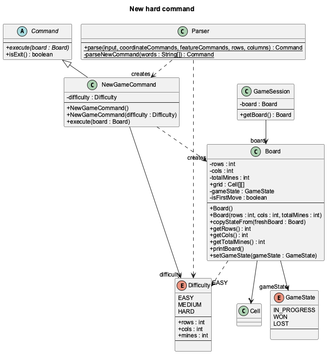
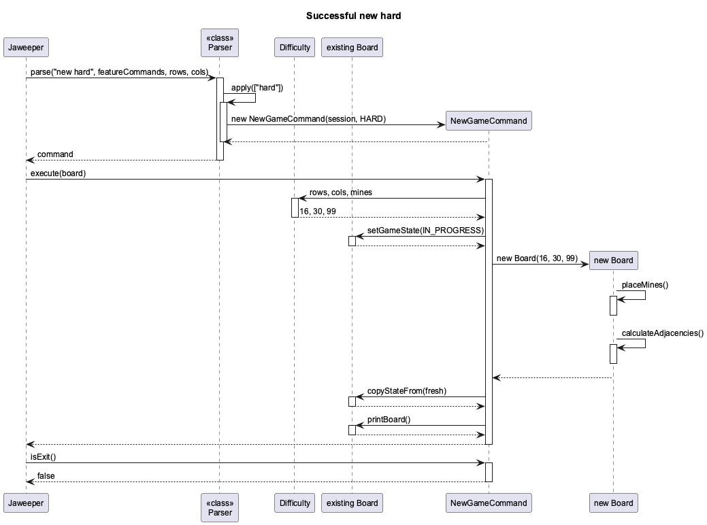
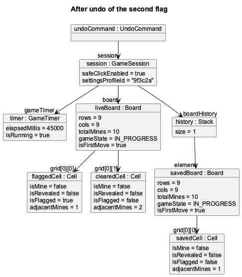
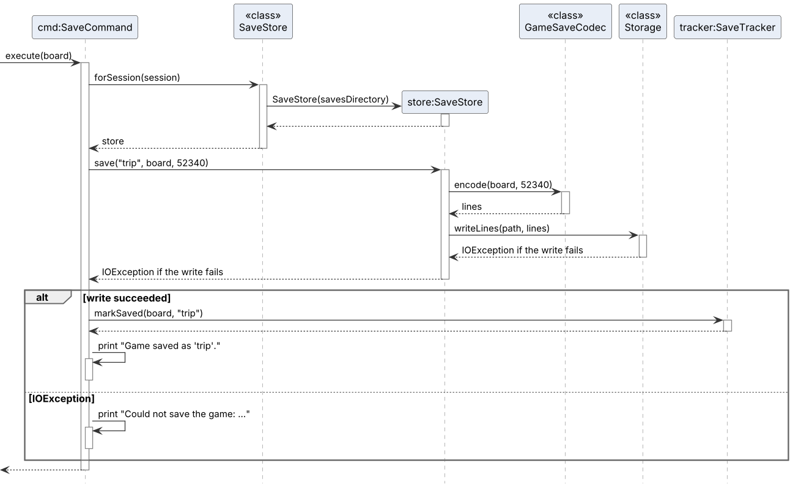
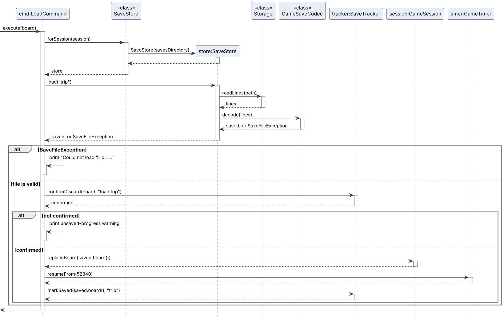
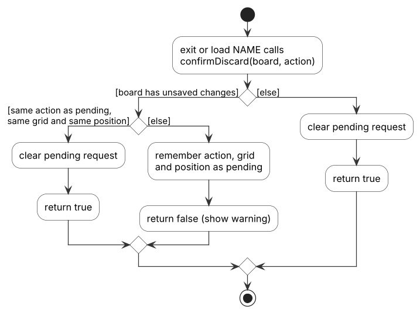

# Developer Guide

Jaweeper is a Java command-line Minesweeper game with local player profiles.
This guide explains its implementation, extension points and verification steps for developers.
For player-facing command instructions, see the [User Guide](UserGuide.md).

The descriptions below distinguish the current implementation from planned work.
A method available to Java callers is not necessarily exposed as a player command.
In particular, startup profile creation/selection is available, while in-game profile management is still pending.

## Contents

- [Product scope](#product-scope)
- [User stories](#user-stories)
- [Setting up and verification](#setting-up-and-verification)
- [Design and implementation](#design--implementation)
  - [Command processing and profile sessions](#command-processing-and-profile-sessions)
  - [Difficulty levels and dynamic boards](#difficulty-levels-and-dynamic-boards)
  - [Statistics and leaderboard](#statistics-and-leaderboard-feature)
  - [Saving and loading games](#saving-and-loading-games)
  - [Gameplay quality-of-life features](#gameplay-quality-of-life-features)
- [Non-functional requirements](#non-functional-requirements)
- [Glossary](#glossary)
- [Instructions for manual testing](#instructions-for-manual-testing)
- [Acknowledgements](#acknowledgements)

## Product scope

### Target user profile

Jaweeper is intended for people who want short, keyboard-driven Minesweeper games in a terminal.
They can run a Java application and enter row/column commands without needing a graphical interface.
Several people may keep separate local profiles on the same computer, using the application one at a time.

### Value proposition

The application provides Minesweeper play, selectable difficulty and named local saves in a command-line workflow.
A player can pause an unfinished game and continue it later under the same profile.
Profiles separate local saved games and settings; they are not authenticated accounts or a privacy boundary.
The application does not provide online multiplayer, cloud synchronisation or simultaneous access to shared data.

## User Stories

These stories summarise the implemented scope and remaining profile work.
Status describes the current command interface, not merely the presence of a model method.

| As a ... | I want to ... | So that I can ... | Current status |
|---|---|---|---|
| New player | view command help | learn the available inputs and coordinate range | Available through `help`. |
| Player | reveal, flag and unflag cells | solve a Minesweeper board using the keyboard | Available through `r`, `f` and `u`. |
| Returning player | create or choose a local profile at launch | keep my saves and settings separate | Available at startup. |
| Player | start an easy, medium or hard game | choose the size and challenge | Available through `new [easy\|medium\|hard]`. |
| Player | save and restore an unfinished game | continue it in a later session | Available through `save` and `load`. |
| Player | list and delete named saves | manage my stored games | Available through `saves` and `delete`. |
| Player | control safe-first-reveal behaviour | choose how the first move behaves | Available through `settings safeclick on\|off`. |
| Player | view statistics and a leaderboard | inspect recorded results | Commands exist; statistics currently remain in memory. |
| Player | create, select, rename or delete profiles during play | manage players without relaunching | Planned; no in-game `profile` route yet. |

## Setting up and verification

Use JDK **25** and Git. Clone the repository and open its root folder as a Gradle project.
Use the committed Gradle wrapper; a separate Gradle installation is not required.
The first build needs Internet access to download build dependencies.

| Path | Purpose |
|---|---|
| `src/main/java/seedu/jaweeper/` | Application, command, model and storage classes. |
| `src/test/java/seedu/jaweeper/` | Unit and integration tests. |
| `config/checkstyle/` | Java style rules enforced by the build. |
| `docs/` | User Guide, Developer Guide and supporting images. |
| `build/libs/jaweeper.jar` | Executable JAR produced by `shadowJar`. |
| `data/` | Runtime data, relative to the directory from which the application is launched. |

From the repository root, run:

```powershell
# Windows PowerShell
.\gradlew.bat check shadowJar
java -ea -jar build/libs/jaweeper.jar
```

On macOS/Linux, use `./gradlew check shadowJar` instead.
`check` runs JUnit tests and Checkstyle; `shadowJar` builds the executable JAR.
The Gradle test and run tasks enable assertions. Use `-ea` when launching the JAR to enable them there too.

JUnit tests that touch persistent data should use temporary directories.
For manual testing, copy the JAR into a separate empty folder and launch it from that folder.
This isolates the test's `data/` directory from existing player data.
Do not use a player's real saves for corruption or deletion tests.

## Design & implementation

### Command processing and profile sessions

**Maintainer:** Zack (zackyesten).
**Implementation scope:** the profile/session foundation introduced in [PR #34](https://github.com/AY2627S1-CS2113-W10-4/tp/pull/34), with the subsequently integrated command routes described below.

This section explains how Jaweeper selects a local player, turns text input into commands, and gives commands access to the same current board and profile. Save/load, statistics, difficulty presets and settings now use this integration. Their domain logic is described in the corresponding feature sections. In-game `profile create/select/rename/delete` commands are not yet registered.

#### Architecture and responsibilities

The implementation separates input coordination, command construction, shared state and file access. These are logical responsibilities within the same Java package, not separate processes or independently deployed components.

| Responsibility | Main classes | Boundary |
|---|---|---|
| Application startup and execution | `Jaweeper`, `ProfileStartup` | Own the input loop and startup selection; delegate feature logic to commands. |
| Input interpretation | `Parser` | Validate syntax and coordinates, then construct a command without executing it. |
| Shared runtime state | `GameSession` | Hold the current `Board`, one shared `ProfileManager`, a timer and the active profile's cached settings. |
| Profile management | `ProfileManager`, `Profile` | Maintain stable player identities, the registry and the session-only active selection. |
| Text persistence | `Storage` | Read/write UTF-8 text; do not interpret saved games or calculate statistics. |

`Jaweeper.main` creates a `ProfileManager` using the working-directory-relative path `data`. Only after startup selection succeeds does it create the initial board and `GameSession`. The session-aware `run` method then delegates to the common execution loop. The older `run(Scanner, Board, ...)` overload remains available for existing tests and does not perform profile selection.

#### Profile component structure


*Figure 1. Selected members and relationships of the profile component. This is a focused diagram, not the complete application class model.*

A `Profile` has an immutable ID and display name, but its `Stats` object is mutable; the whole object is therefore not immutable. The diagram shows selected identity members and omits statistics, timer and settings details.

`ProfileManager.renameProfile` replaces the profile object while preserving its UUID. The active selection stores the ID, so subsequent lookups obtain the renamed profile. Consumers should obtain the current profile when needed rather than cache an old object. The current replacement constructs fresh statistics: preserving statistics is still required before exposing rename as an in-game command.

`GameSession` holds one replaceable board reference. Following `replaceBoard(validatedBoard)`, the next command receives the replacement through `getBoard()`. Replacement itself does not validate saved-game contents, handle unsaved progress or update timers. Those operations remain the responsibility of the calling feature.

#### Startup selection and profile persistence

At the startup prompt, `create NAME` creates and explicitly selects a profile; `select NUMBER` selects an entry from the displayed list. The displayed number is a temporary user-facing index, not the persistent identity. `exit` or end-of-input cancels startup before a board is created. Invalid choices are reported and the prompt repeats.

`ProfileManager.createProfile` alone does not select its result. Keeping these operations separate lets another caller create a profile without changing the current player. Startup deliberately performs both operations. Active selection is not written to disk, so the next launch prompts again.

The registry is a human-readable UTF-8 file, `data/profiles.txt`. Its first line is `profiles-v1`; each following line contains a canonical UUID, a tab, and a display name. Names are trimmed, must contain 1–30 permitted characters, and must start with a letter or digit. Unicode letters/digits, spaces, underscores and hyphens are allowed; tabs and line breaks are not. Name uniqueness ignores case.

A missing registry means first-time use. An existing empty file, invalid header, malformed record, duplicate ID or duplicate name is instead an error. Startup must not silently replace such a file with an empty registry. Permission and other read errors are also reported, rather than interpreted as "no profiles".

For a registry change, the manager builds a candidate map, serializes it, and calls `Storage.writeLines` before replacing its in-memory map. Storage creates parent directories and writes a temporary file alongside the target, then attempts an atomic replacement. A non-atomic replacement is used if atomic moves are unsupported. This reduces exposure to partially written files but is not a universal crash-recovery guarantee or a multi-process transaction system.

A player's feature data belongs under `data/profiles/<UUID>/`. Changing a display name does not change this path. The directory accessor does not create it; a subsequent storage write creates parents as needed. The foundation's delete operation rejects the active profile and removes only an inactive profile's registry record. Associated feature files are retained. A future deletion UI must explain that behaviour rather than claim all data was erased.

#### Command parsing and execution

For each command on an input line (a line may chain several commands, see [Gameplay quality-of-life features](#gameplay-quality-of-life-features)), the session-aware loop reads the current board dimensions and passes them to `Parser.parse`. Command names are lowercased with `Locale.ROOT`; argument case is preserved.

Dispatch follows this order:

1. If a matching lowercase key exists in the feature registry, invoke its `Function<String[], Command>` factory with the argument tokens, excluding the command name.
2. Otherwise, handle built-in `help`, `exit`, `new` and `board`. `help`, `exit` and `board` reject extra arguments. `new` accepts an optional difficulty word, described under [Difficulty levels and dynamic boards](#difficulty-levels-and-dynamic-boards). (`clear` is also a built-in, but its case is currently commented out; see [The clear command](#the-clear-command-temporarily-disabled).)
3. For `r`, `f` and `u`, validate two integer coordinates against separate row/column limits, convert from one-based input to zero-based indices, and invoke the registered coordinate factory.

Unknown commands and invalid arguments produce `IllegalArgumentException` messages. The loop displays the message and continues. Factories construct commands; they must not mutate gameplay or perform persistence as a parsing side effect.


*Figure 2. Successful processing of `f 2 3`. The board has at least two rows and three columns. Scanner calls, logging, lambda adapters and the internals of flagging are omitted.*
*Figure 2. Successful processing of `f 2 3`. The board has at least two rows and three columns. Scanner calls, logging, lambda adapters, the loop's game-over checks and the internals of flagging are omitted to keep the diagram focused. The call to parse represents the invocation through the loop's parsing function. Dashed arrows are returns; the command instance begins at its creation message.*

The parser converts the coordinates to `(1, 2)` before calling the flag factory. It returns the resulting command to the loop, which obtains the current board immediately before `execute(board)`. After successful execution, the loop checks `isExit()`. A true result ends the loop. Otherwise, it proceeds to the next segment or input line, except that a transition to a finished game skips the remaining segments on that line. An `IllegalArgumentException` thrown during execution is also reported and the loop continues, but the loop does not roll back any mutations already made by that command.

Existing commands keep the `Command.execute(Board)` contract. A feature that also needs profiles can accept `GameSession` in its constructor. Registration in `Jaweeper.createFeatureCommands(session)` supplies that same session to its factory. `hint` is registered there and does not replace a built-in command.

Feature registrations take precedence over built-ins. For example, the registered `new` factory handles both `new easy` and plain `new`, and supplies the session to `NewGameCommand`. The registered `exit` supplies the shared save tracker, while the fallback exit constructor remains immediate for legacy callers. Whitespace tokenization does not implement quoting. Semicolon-separated chains are split by the execution loop before parsing, so `Parser` itself still handles exactly one command per call.

#### Defensive checks and error boundaries

User input is checked with ordinary conditionals and exceptions, not assertions. For example, invalid coordinate text is rejected even when Java assertions are disabled. Assertions instead document internal invariants, including validated coordinate bounds and non-null results from command factories. Gradle's test and run tasks enable assertions; a direct JAR launch can use `java -ea -jar jaweeper.jar`.

Session/profile preconditions also have distinct meanings: `ProfileManager.getActiveProfile()` returns an `Optional`, while `GameSession.getActiveProfile()` throws `IllegalStateException` if startup selection was omitted. Session construction and board replacement reject null references.

The application logs session start/end at INFO and command dispatch/rejected input at FINE. It does not log complete user command lines for these dispatch messages. Startup registry read failures are reported without replacing the registry. Because `execute(Board)` does not declare checked I/O exceptions, file-based commands must handle their own `IOException` and must not report success after a failed write.

EOF currently ends the game loop directly; it does not execute an exit command. Consequently, the registered exit command's unsaved-progress check does not protect EOF.

#### Design decisions and alternatives

| Decision | Alternative considered | Reason and trade-off |
|---|---|---|
| Stable UUID identity, separate from display name | Use the name as a filename/key | Renames do not break save/statistics references; IDs are less convenient for users, so startup displays numbered names. |
| Pass one GameSession to feature commands | Static global state or a new manager per command | Explicit sharing is easier to isolate in tests and avoids independent active selections; constructors need an extra dependency. |
| Preserve execute(Board) and add feature factories | Rewrite every command to accept a new context | Existing commands/tests remain compatible; profile-aware commands carry session state in addition to receiving the board. |
| Save a candidate registry before replacing the in-memory map | Mutate the map and then write | A failed write does not make memory claim that a registry update succeeded; replacement requires a temporary copy. |
| Generic text storage | One storage class owning profiles, boards and statistics | Each owner controls their format without expanding one shared class; each feature must supply its own validation and error policy. |

#### Verification and remaining work

The automated tests separate parser behaviour, startup interaction and file-system state:

- `CoreCommandsTest` and `GameplayRoutingTest` cover the existing command routes and zero-based coordinate conversion.
- `ParserAssertionsTest` checks enabled assertions, a null command-factory result, and invalid-input exceptions.
- `ProfileStorageTest` uses JUnit temporary directories to exercise persistence, duplicate names, malformed registries, retained feature files and failed-write behaviour.
- `ProfileRuntimeTest` covers startup creation/selection, cancellation, recovery from invalid input, shared session access, feature overrides, rectangular coordinate limits and board replacement.

Run `./gradlew clean build` (Windows: `.\gradlew.bat clean build`) before submitting changes. The rectangular routing test checks the parser/session adapter; it is not evidence that all Board algorithms already support rectangular games.

This foundation does not yet supply in-game profile create/select/rename/delete commands, deletion confirmations, unsaved-game protection, saved-game restoration or statistics updates. Difficulty presets and `hint` are described in the next section. The session loop reads the current board's row and column counts through `GameSession`. Legacy `Parser.parse` overloads validate coordinates against the easy preset. Later features must update the relevant integration points and their documentation when behaviour changes.

See [the integration contract](ProfileIntegration.md) for the factory interface and ownership boundaries. Other team members should add their own implementation sections alongside this one.

### Difficulty levels and dynamic boards

**Maintainer:** Pranav (ProNoob116).

`Board` stores `rows`, `cols` and `totalMines`. Mine placement, adjacency counts, flood fill, victory checking and printing all use those values. `Board.SIZE` and `Board.MINES` remain only so older tests can describe the easy board. New code should use `getRows()`, `getCols()` and `getTotalMines()`.

#### Creating a board

`Difficulty` holds the three presets. The no-argument `Board` constructor uses `Difficulty.EASY`.

| Preset | Command | Rows | Columns | Mines |
|---|---|---|---|---|
| `EASY` | `new` or `new easy` | 9 | 9 | 10 |
| `MEDIUM` | `new medium` | 16 | 16 | 40 |
| `HARD` | `new hard` | 16 | 30 | 99 |

`Jaweeper.createFeatureCommands` registers `new`. That factory builds a `NewGameCommand` for a preset. `Parser.parseNewCommand` does the same when no `new` factory is present, which is how the older parser tests still start a game.

`NewGameCommand` stores one `Difficulty`. On `execute` it builds a sized `Board` and copies that grid into the board the session already holds. `GameSession` keeps the same `Board` reference. The next command sees the new size through `getRowCount()` and `getColumnCount()`.



*Figure 3. Classes involved in `new hard`. Source: [diagrams/new-hard-class-diagram.puml](diagrams/new-hard-class-diagram.puml). `GameSession` keeps one `Board`; `new hard` changes that object instead of replacing the session's reference.*

`new hard` uses the current dimensions only to validate later `r`, `f` and `u` commands. They do not choose the size of the new game.

1. `Parser.parse` finds the `new` factory and calls `apply` with `["hard"]`.
2. The factory selects `Difficulty.HARD` and returns `new NewGameCommand(session, Difficulty.HARD)`. Any other single word throws `IllegalArgumentException` with `Usage: new [easy|medium|hard]`. The loop prints that message and leaves the board unchanged.
3. `execute` sets `GameState.IN_PROGRESS` and constructs `new Board(16, 30, 99)`. That constructor places 99 mines and calculates adjacencies. The first reveal is still protected by safe-first-click.
4. `copyStateFrom` copies `rows`, `cols`, `totalMines`, `grid` and `isFirstMove`. It does not call `GameSession.replaceBoard`.
5. The command starts the session timer when a session is present, prints `New hard game started.`, and prints the board. The header reports `Remaining Mines: 99`. `isExit()` is false, so the loop prompts again.



*Figure 4. Successful `new hard`. Source: [diagrams/new-hard-sequence-diagram.puml](diagrams/new-hard-sequence-diagram.puml). Scanner reads, logging and the mine-placement loops are omitted.*

`new easy` and a bare `new` print `New easy game started.` `new medium` prints `New medium game started.`

#### Custom boards

`new custom ROWS COLS MINES` is handled by the same `new` factory, before the preset check. `CustomGameCommand` accepts the command only when:

- both dimensions are integers from 5 to 50,
- the mine count is an integer of at least 1 and strictly less than the number of cells.

A valid command clears the undo history, builds that board, and prints `New custom game started (RxC, M mines).`

#### Executing undo

`GameSession` keeps a `Stack<Board>`. Before a reveal, flag or unflag changes the board, the command pushes `Board.deepCopy()`. `undo` pops that copy and `copyStateFrom` writes it onto the live board, so the session still holds the same `Board` object. The timer is left running. An empty stack prints `Nothing to undo.`

The snapshot below is an easy game after two flags and one `undo`. The second flag is gone. The stack still holds the board from before the first flag, and the timer shows 45 seconds already spent.



*Figure 7. Memory after `undo` removed the second flag. Source: [diagrams/UndoObjectDiagram.puml](diagrams/UndoObjectDiagram.puml).*

#### Hint command

`hint` is separate from difficulty selection. `Jaweeper.createFeatureCommands` registers it under the lowercase name `hint`, so the feature factory runs before the built-in switch and the command cannot be confused with `new`. `HintCommand.create` rejects extra arguments with `Usage: hint`.

`execute` does not change the board. If the game is already over, it prints `The game is over. Type 'new' to start a new game.` Otherwise it scans revealed safe cells. When a cell's adjacent flag count equals its number, every hidden unflagged neighbour is treated as safe, and the command prints the first such cell in one-based coordinates, for example `Try revealing cell (4, 7).` If no such cell exists, it prints `No safe cell can be deduced yet. Reveal more cells.` An empty, ragged or incomplete grid throws `IllegalArgumentException`; the command catches it, prints the message and returns, so the input loop continues. Assertions check that a chosen hint is inside the current dimensions and refers to a hidden, unflagged cell. They do not claim the cell is free of a mine, because that depends on the player's flags being correct.

### Statistics and Leaderboard Feature

The statistics module tracks performance in the active profile's in-memory `Stats` object. The current implementation does not persist these statistics across application launches.

#### Architecture and Components

- **`Stats` Model**: Maintains counts for wins, losses, current win streaks, maximum win streaks, and a historical list of completion times.
- **`GameTimer`**: Tracks elapsed duration using wall-clock millisecond timestamps (`System.currentTimeMillis()`). Commands start, stop or restore it; constructing a session alone does not start it.
- **Persistence boundary**: `profiles.txt` stores profile IDs and names, not statistics. Each constructed `Profile` currently creates a fresh `Stats`. A future statistics file needs its own format, validation and load/save integration.

#### Command Summary & Syntax

| Command | Format | Description | Example |
| :--- | :--- | :--- | :--- |
| **Stats** | `stats` | Displays wins, losses, win rate, streaks and the fastest-time field for the active profile. | `stats` |
| **Stats Clear** | `stats clear` | Resets all recorded wins, losses, streaks, and times for the active profile. | `stats clear` |
| **Leaderboard** | `leaderboard` | Displays registered profiles and their in-memory wins, losses and win rates. | `leaderboard` |

### Saving and loading games

**Maintainer:** Yong Xiang (yongxiang22).

This feature lets a player save an unfinished game to a readable text file and continue it later with the time already spent. Before quitting or loading, the player is warned if the current game has unsaved moves. Corrupted or hand-edited save files are rejected without touching the game in progress.

#### Overview

The feature adds five classes and makes small additions to four existing ones. Figure 3 shows how they fit together.


*Figure 3. Classes of the save/load component and the existing classes they use. Only the members discussed below are shown.*

| Class | Responsibility |
|---|---|
| `SaveCommand`, `LoadCommand` | Parse their arguments when the command is created (no file access) and carry out the operation in `execute`. |
| `SaveStore` | Owns save-name rules and file locations, `data/profiles/<UUID>/saves/<name>.txt`. Provides `save`, `load`, `list`, `delete` and `exists`. Uses the shared `Storage` helper for the actual reading and writing. |
| `GameSaveCodec` | Converts a `Board` plus elapsed time to save-file lines and back, validating every line on the way in. Knows nothing about files or paths. |
| `SaveTracker` | Remembers the position at the last save or load and decides whether the current game has unsaved progress. |
| `SaveFileException` | A checked exception whose message is shown to the player as-is. |

`Jaweeper.createFeatureCommands` creates **one** `SaveTracker` and passes it to the `save`, `load` and `exit` factories, so all three agree on what was last saved. The `exit` registration overrides the built-in `exit`; the no-argument `ExitCommand()` constructor still quits immediately, so existing tests are unaffected.

Two small hooks were added to existing classes: `Board.restore(...)` builds a board from given cells without placing random mines, and `GameTimer.resumeFrom(ms)` / `getElapsedMillis()` let the timer continue from a saved duration.

#### Saving a game

Figure 4 shows what happens when the player types `save trip`.



*Figure 4. Successful `save trip`. Logging, the overwrite check and the failed-write branch are omitted.*

1. The parser passes `["trip"]` to `SaveCommand.parse`, which checks and lowercases the name. The name may contain only letters, digits, `_` and `-`, so it can never contain `/` or `..` and escape the saves folder. Windows-reserved names such as `con` and `nul` are also rejected.
2. `execute` refuses finished games, since there is nothing left to continue and the result is already recorded in the statistics.
3. `SaveStore` asks `GameSaveCodec.encode` for the file contents, then writes them with `Storage.writeLines`. `Storage` writes to a temporary file first and attempts atomic replacement. Its fallback on file systems without atomic moves is not a universal guarantee that the old save survives every replacement failure.
4. Only after the write succeeds does `SaveCommand` call `tracker.markSaved`. If the write throws an `IOException`, the command prints the error and does **not** mark the game as saved, so the exit warning still protects the player's progress.

Plain `save` (no name) re-saves to the name this game was last saved to or loaded from, which `SaveTracker.getCurrentSaveName` provides.

#### Save file format

```
jaweeper-save-v1
size 3 4
mines 2
elapsed-ms 52340
board
00.x
11f.
1F..
checksum 623d2492
```

| Symbol | Meaning |
|---|---|
| `.` | Hidden cell, no mine |
| `x` | Hidden mine |
| `f` | Flag on a safe cell |
| `F` | Flag on a mine |
| `0`–`8` | Revealed safe cell, showing its adjacent-mine count |

The board section looks like the game board itself, so a developer can read a save while debugging. The last line is a CRC32 checksum of every line above it, written as 8 lowercase hex digits.

#### Loading a game

Figure 5 shows `load trip`, including the two places where loading can stop.



*Figure 5. `load trip`. The outer `alt` is the file check; the inner `alt` is the unsaved-progress check. `Storage.readLines` is shown as a self-call to keep the diagram narrow.*

The key design point is the **order**: `LoadCommand` reads and fully decodes the file *before* asking for confirmation or replacing anything. Only after both checks pass does it call `replaceBoard`, `resumeFrom` and `markSaved`. A failed load therefore leaves the current game exactly as it was.

`GameSaveCodec.decode` never trusts the file. It rejects the file with a message naming the line, where possible, if:

1. The header `jaweeper-save-v1` is missing or different.
2. The checksum line is missing or does not match. This catches truncated files, disk damage and hand edits.
3. The `size`, `mines` or `elapsed-ms` line is malformed, including signs, non-digits and over-long numbers.
4. Rows or columns are outside 1–99, or the mine count is outside 1 to (cells − 1).
5. A board row has the wrong length or an unknown symbol, or there are too many or too few rows.
6. The number of mines in the grid differs from the `mines` line.
7. A revealed number does not match the recalculated count. `Board.restore` always recalculates adjacency itself, so the file's numbers are only checked, never used.
8. Every safe cell is already revealed, which means the game is finished.

The checksum is checked first so a hand-edited file gets a clear "changed outside Jaweeper" message. Checks 3–8 still matter: they catch files written by a buggy future version, and they stop bad data from reaching `Board`'s assertions.

Whether a game was saved before its first reveal is worked out from the grid (no revealed cells), so the safe-first-click rule still applies after loading such a game.

#### Detecting unsaved progress

Rather than adding a `markDirty()` call to every command that changes the board, `SaveTracker` compares the board with a snapshot taken at the last save or load. Figure 6 shows the decision made by `confirmDiscard`, which both `exit` and `load` call.



*Figure 6. How `SaveTracker.confirmDiscard` decides whether `exit` or `load` may go ahead.*

- `markSaved(board, name)` stores a reference to the board's grid array and the grid's encoded rows.
- A board has unsaved changes if the game is unfinished, at least one cell is revealed or flagged, and either the grid is a **different array** from the snapshot (`new` or another load replaced it) or its rows differ.
- The first progress-losing request remembers the action (`"exit"` or `"load trip"`) and the current position, prints a warning and returns `false`. Repeating the **same** action with no move in between returns `true`. Any move, or a different action, needs a fresh confirmation.

Comparing the grid array by identity also stops plain `save` from overwriting the previous game's file after `new`, because `NewGameCommand` installs a fresh grid array through `copyStateFrom`. The comparison is one pass over the grid per `exit`, `load` or `save`, which is negligible for boards up to 99×99.

#### Design decisions and alternatives

| Decision | Alternative considered | Reason and trade-off |
|---|---|---|
| Readable text with a CRC32 checksum | Binary or Java serialisation | Readable files help debugging and suit the course's text-file requirement. CRC32 detects edits and damage but is not tamper-proof against someone who recomputes it; that is acceptable for a single-player game. |
| Recalculate adjacency on load | Trust the numbers in the file | One source of truth; the stored digits still keep the file readable and act as an extra consistency check. |
| Validate everything before replacing the board | Load cell by cell into the live board | No half-loaded game on error, at the cost of building a second board in memory. |
| Snapshot comparison for unsaved changes | A dirty flag set by each command | No changes to teammates' commands, and new commands are covered automatically. |
| Type the same command twice to confirm | A separate `y/n` prompt | Works within the existing one-line-per-command loop with no new input mode; the trade-off is a less familiar confirmation style. |
| Lowercase, restricted save names | Free-form names | Prevents path traversal (`../`), Windows-reserved names, and names that differ only in case colliding on Windows and macOS. |

#### Testing and known limitations

- `GameSaveCodecTest` covers round trips (including a random 16×30 board), checksum tampering and truncation. It also tests each content check above using files with a *valid* checksum, so only the content check can catch the problem.
- `SaveLoadCommandsTest` uses JUnit temporary folders to test the store, name validation, saving and loading, re-saving, refusing finished games, keeping the current game after a bad load, both confirmation flows, and a full run through `Jaweeper.run`.

**Limitations and planned work:**

- Pressing Ctrl-D (end of input) ends the loop without the unsaved-progress warning, because it bypasses commands. A future change could auto-save to a reserved slot on end of input.
- Runtime profile switching, once added, must call `SaveTracker.confirmDiscard` before changing profile, since saves belong to one profile.
- The `saves` and `delete NAME` commands call `SaveStore.list()` and `SaveStore.delete(name)` rather than building paths themselves; see [Gameplay quality-of-life features](#gameplay-quality-of-life-features).

### Gameplay quality-of-life features

**Maintainer:** Zhe Wen (zzzwun).

This section covers five additions that make the game nicer to play: showing every mine after a loss, a per-profile safeclick setting, chaining several commands on one line, listing and deleting saved games, and an updated `help`. It also documents `clear`, which is implemented but currently disabled.

#### Command summary & syntax

| Command | Format | Description | Example |
| :--- | :--- | :--- | :--- |
| **Settings** | `settings` | Shows the active profile's settings. | `settings` |
| **Safeclick** | `settings safeclick on\|off` | Turns the guaranteed-safe first reveal on or off for the active profile. Saved across launches. | `settings safeclick off` |
| **Saves** | `saves` | Lists the active profile's saved games alphabetically. | `saves` |
| **Delete** | `delete NAME` | Deletes a saved game. Must be typed twice to confirm. | `delete trip` |
| **Chaining** | `COMMAND; COMMAND; ...` | Runs several commands from one input line. | `f 1 1; f 2 3` |
| **Clear** *(disabled)* | `clear` | Clears the terminal. | `clear` |

#### Showing all mines after a loss

`RevealCommand.revealMine` sets the game state to `LOST` and then calls `board.printBoard()`. While the state is `LOST`, `Board.iconFor(cell)` chooses what each cell looks like, instead of always using `Cell.getIcon()`:

| Cell | Shown as |
|---|---|
| Mine, not flagged | `*` |
| Flag on a safe cell | `X` |
| Flag on a mine | `F` (unchanged) |
| Anything else | Whatever `Cell.getIcon()` returns |

This is display only: no `isRevealed` flag is changed. That keeps `calculateCompletionPercentage`, the statistics and any later snapshot of the grid unaffected by the loss screen. The `board` command shows the same view for as long as the game stays lost, and `new` resets the state, so mines are hidden again in the next game.

#### Safeclick setting

| Class | Responsibility |
|---|---|
| `SettingsCommand` | Parses `settings` and `settings safeclick on\|off` when created (no file access) and displays or changes the setting in `execute`. |
| `ProfileSettings` | Reads and writes `data/profiles/<UUID>/settings.txt`. Static methods only; knows nothing about commands. |
| `GameSession` | `isSafeClickEnabled()` and `setSafeClickEnabled(boolean)`. Caches the value for the active profile so a reveal does not read a file. |
| `Board`, `RevealCommand` | On the first reveal, `RevealCommand` calls `ensureSafeFirstClick` if safeclick is on, or the new `skipSafeFirstClick` if it is off. |

The file is two lines: the header `jaweeper-settings-v1`, then `safeclick on` or `safeclick off`. It is kept apart from `profiles.txt` on purpose, because the registry is strictly validated and a change to its format would affect every profile.

How the value is read and written:

- A missing, unreadable or malformed file means the default (on). The file is not overwritten until the player changes a setting, so a hand-edited file is not silently destroyed.
- `setSafeClickEnabled` writes the file first and only then updates the cached value, the same policy as the profile registry. If the write fails, `SettingsCommand` reports the error and nothing changes.
- The cache is keyed by the active profile's ID, so selecting another profile in the same session reads that profile's own value.
- With no session (legacy test usage) or no active profile, safeclick is on, which matches the behaviour before this feature.

`skipSafeFirstClick` clears the board's first-move flag without moving any mines. Without it, turning safeclick off would leave the flag set, and a later reveal could still trigger the mine relocation. The setting is checked when the first reveal happens, so a game that has not been revealed yet follows the current value, while a game already in progress is unaffected.

#### Command chaining

`Jaweeper.runLoop` now hands each input line to `runLine`, which uses `splitChain` to split it on `;` and then runs each segment in turn:

1. `splitChain` trims each segment and drops empty ones, so `f 1 1;; f 2 3;` works. A line with no commands at all is passed through unchanged so the parser still reports "Enter a command".
2. Each segment is parsed **just before it runs**, not all up front. This matters because the board can change partway through a line: in `new hard; f 15 29`, the coordinate `15 29` is only valid on the 16×30 board that `new hard` creates. Parsing lazily lets `Parser` validate against the board as it is at that moment.
3. If parsing or executing a segment throws `IllegalArgumentException`, the message is printed and the **next segment still runs**.
4. If a segment is an accepted `exit`, the loop ends and later segments are not run.
5. If the game ends during a segment (a win or a loss) and more segments remain, they are skipped and one line says how many. Without this, every remaining `r`, `f` or `u` would print its own "The game is over" message.

`Parser` is unchanged and still handles one command per call. Doing the split in the loop means both `run` overloads, including the legacy test entry point, get chaining.

Two consequences to be aware of. First, `exit; exit` counts as the confirming repeat for the unsaved-progress warning, because `SaveTracker.confirmDiscard` compares the action and the board position, not how many input lines were typed. `delete x; delete x` behaves the same way. Second, `;` cannot appear inside a command's arguments; this is already true because save names allow only letters, digits, `_` and `-`.

#### Listing and deleting saves

`SavesCommand` calls `SaveStore.list()` and prints the names, or a hint to use `save NAME` if there are none. `DeleteCommand` uses `SaveStore.exists` and `SaveStore.delete`. Both work only inside the active profile's saves folder, as `SaveStore` already guarantees.

`delete NAME` follows the same "type it twice" convention as `exit` and `load`:

1. If no save has that name, a message is printed and any pending confirmation is cleared.
2. Otherwise, the first request prints a permanent-deletion warning and remembers the name.
3. Typing the same `delete NAME` again deletes the file. Requesting a different name replaces the remembered one, so each save needs its own confirmation.

Command objects are created fresh for every input line, so the remembered name lives in a `DeleteCommand.Confirmation` object. `Jaweeper.createFeatureCommands` creates one and passes it to every `delete` command, in the same way it shares one `SaveTracker`. `SaveTracker.confirmDiscard` is not reused here because it asks "does the current board have unsaved moves?", which is unrelated to deleting a file.

`delete` also calls the new `SaveTracker.forgetSave(name)`. If `name` is the save that the current game was last saved to or loaded from, the tracker forgets it. The game then counts as unsaved again, so `exit` warns, and a plain `save` has no name to reuse and asks for one. `forgetSave` returns whether it did this, and `DeleteCommand` prints a note when it did. Because deleting does not decode the file, a corrupted save that cannot be loaded can still be deleted.

#### The clear command (temporarily disabled)

`ClearCommand` prints the ANSI sequence `ESC[H ESC[2J ESC[3J` (move the cursor home, erase the screen, erase the scrollback) and flushes. It does not touch the game state and does not reprint the board.

The command is currently disabled in three places. To re-enable it:

- Uncomment the `case "clear"` branch in `Parser.parse`.
- Uncomment the `clear` line in `HelpCommand`.
- Remove `@Disabled` from `clear_printsAnsiClearSequence_andKeepsBoard` in `ClearAndHelpCommandTest`, then run the test.

Terminals that understand ANSI codes clear correctly. Some IDE consoles ignore the codes, in which case nothing visible happens.

#### The help command

`HelpCommand` groups commands by purpose (playing, saved games, player, other) and prints them through a small `printEntry` helper so the descriptions line up. It also explains chaining. The coordinate range is read from the `Board` passed to `execute`, so on a 16×30 board it shows "rows 1 to 16, columns 1 to 30" rather than the deprecated `Board.SIZE`. When a command is added or removed, its `printEntry` line must be updated too.

#### Design decisions and alternatives

| Decision | Alternative considered | Reason and trade-off |
|---|---|---|
| Draw mines in `printBoard` while the state is `LOST` | Set `isRevealed` on every mine when the game is lost | The display change cannot affect completion percentage, statistics or snapshots. The cost is that the rule lives in `Board.iconFor` rather than in `Cell`. |
| Store safeclick in a separate `settings.txt` per profile | Add a column to `profiles.txt` | The registry stays strictly validated and its format unchanged. A second file per profile has to be read and written separately. |
| Fall back to the default and never overwrite a bad settings file | Fail startup on a malformed file | A damaged setting should not stop the game, and the player's file is kept until they choose to change it. A typo in the file is silently ignored. |
| Split chains in `Jaweeper`, parse each segment when it runs | Teach `Parser` to return a list of commands | Commands can change the board (`new`, `load`), so later segments must be validated against the updated board, and both `run` overloads get chaining. Parsing errors appear only when the segment is reached. |
| Keep running after a failed command in a chain | Stop at the first error | The player sees every error and the valid commands still apply. A mistake early in a line does not cancel later commands that may depend on it. |
| Skip the rest of a line when the game ends | Run every command and let each report "game over" | One note replaces a wall of repeated messages. The player cannot chain a `new` after a game-ending move on the same line. |
| Share one `DeleteCommand.Confirmation` between delete commands | Store the pending name in `SaveTracker` or a static field | A command object lives for only one input line, so the state must be shared. A dedicated object keeps delete logic out of `SaveTracker` and avoids global state. |
| `forgetSave` on delete | Leave the tracker unchanged | Otherwise `exit` would stay silent for a game whose save file no longer exists. One more method on `SaveTracker`. |

#### Testing and known limitations

The tests share setup (a temporary profile folder, captured output, a script runner) through the abstract class `SessionTestBase`:

- `LossRevealTest` checks `*`, `X` and `F` after a loss, that cell state is unchanged, and that an in-progress board hides mines.
- `SettingsCommandTest` covers safeclick on and off, persistence across a simulated restart, separate values per profile, invalid arguments and a malformed settings file.
- `CommandChainingTest` covers `splitChain`, errors in the middle of a line, `exit`, parsing against a board changed by `new hard`, the game-ending skip and blank lines.
- `SavesAndDeleteCommandTest` covers listing, the two-step delete, a different name needing a fresh confirmation, missing or invalid names, and the effect of deleting the current game's save on `exit`.
- `ClearAndHelpCommandTest` covers the ANSI output and the help text. The `clear` test is currently `@Disabled`.

**Known limitations:**

- `exit; exit` and `delete x; delete x` on a single line count as confirmed repeats, as described under command chaining.
- `clear` depends on the terminal understanding ANSI codes, and is disabled for now.
- Safeclick changes apply at the next first reveal, not to a game already in progress.
- `UserGuide.md` does not yet describe these commands.

## Non-Functional Requirements

The following are development targets. A target is not evidence that every operating system or failure mode has been tested.

| Area | Requirement and verification |
|---|---|
| Runtime | The application and tests use Java 25. Verify the packaged JAR with Java 25, not only through an IDE. |
| Interface | Core play is accessible through text commands in a terminal. User-facing coordinates are one-based. |
| Offline operation | After obtaining the JAR and Java runtime, gameplay uses local files and requires no remote service. Build dependency downloads are separate. |
| Input handling | Invalid command syntax or coordinates produce an explanatory message and leave the input loop usable. These checks must work without assertions. |
| Persistence | Persistent files use UTF-8 text. Registry and save-file readers validate their own formats before accepting data. File failures must not be reported as successful saves. |
| Data separation | Saved games and settings use the profile's stable UUID directory. Display-name changes must not alter those paths. |
| Maintainability | Submitted Java changes should pass the repository's JUnit tests and Checkstyle checks. File-related tests use isolated temporary directories. |
| Usage limits | One application instance accesses a data directory at a time. Concurrent writers, authenticated accounts and crash recovery across multiple files are outside the current design. |

## Glossary

| Term | Meaning |
|---|---|
| Board / cell | The rectangular grid / one position in that grid. A cell may contain a mine and may be revealed or flagged. |
| Reveal | Open a cell. A safe cell displays its adjacent-mine count; revealing a mine loses the game. |
| Flag | Mark a suspected mine without revealing it. A flag is a player's guess, not proof that a mine is present. |
| Flood fill | Expansion from a blank cell to connected blank cells and their numbered boundary. |
| Safeclick | The setting controlling protection for the first reveal of a game. |
| Profile / UUID | A local player's record / the stable identifier used for that player's data paths. |
| GameSession | Shared runtime access to the current board, profile manager, timer and settings. |
| Command factory | A function that validates arguments and constructs a command for later execution. |
| Unsaved progress | Board changes not matching the save tracker's last saved/loaded position; see the save/load section for the exact rule. |
| EOF | End of input. The current loop exits directly when its input stream ends. |

## Instructions for manual testing

### Preparation

Build the JAR as described in [Setting up and verification](#setting-up-and-verification).
Copy it into a separate empty folder, open a terminal in that folder and run `java -ea -jar jaweeper.jar`.
Keep using that working directory when testing persistence across launches.
The following are repeatable checks and expected outcomes, not a record of tests already executed.

### Startup and profile persistence

1. At the first startup prompt, enter `create DG Tester`. Expect a selected profile and a fresh board.
2. Enter `exit` before making a move. Relaunch from the same directory; expect `DG Tester` in the profile list.
3. Enter `create dg tester`. Expect a duplicate-name error and another startup prompt.
4. Enter `select 999`. Expect an invalid-selection message and another prompt.
5. Select the number actually shown beside `DG Tester`. Expect entry into the game.
6. Check that `data/profiles.txt` contains a `profiles-v1` header and a UUID/name record.
   The numbered startup choice is not written as the profile's identity.

For a registry-corruption check, use a second isolated test folder.
Create and exit a test profile, then change only that folder's registry header to `invalid-header`.
Relaunch: expect a registry error and no replacement registry. Do not run this check against real player data.

### Parser, dimensions and command chaining

Run these commands in order after selecting a test profile:

| Input | Expected outcome |
|---|---|
| `new hard` | A 16-row, 30-column board. |
| `f 16 30` then `board` | The bottom-right cell is flagged. |
| `u 16 30` then `board` | That flag is removed. |
| `r 0 1`, `r 17 1`, `r 1 31`, `r abc 1` | Each input is rejected; the process continues without revealing a cell. |
| `new impossible` | A usage error; the current board remains available. |
| `new easy; f 9 9; board` | A 9-by-9 board with its bottom-right cell flagged, demonstrating parsing after the earlier board change. |
| `unknown; board` | An unknown-command message followed by the board, demonstrating that a failed segment does not cancel the rest. |

Board generation is random. Check dimensions, flags and state changes rather than an exact mine layout.
Use controlled boards in unit tests for deterministic win, loss and flood-fill cases.

### Save, restore and unsaved-progress protection

1. Enter `new easy`, `f 1 1`, then `save dg-check`. Expect a success message.
2. Enter `u 1 1`, then `load dg-check`. Expect an unsaved-progress warning; the unflagged board should remain.
3. Repeat `load dg-check` without changing the board. Expect the saved board with the flag at `1 1`.
4. Enter `saves`. Expect `dg-check` in the list.
5. Enter `load no-such-dg-save` with a name absent from the list. Expect an error and no board replacement.
6. Enter `u 1 1`, then `exit`. Expect a warning and a live command prompt.
7. Repeat `exit` without changing the board. Expect the application to close.
8. Relaunch, select the same profile and enter `load dg-check`. Expect the saved flag to return.

These checks exercise the registered production commands. They do not imply that `new` or EOF has the same unsaved-progress protection.

### Per-profile settings

1. With `DG Tester` selected, enter `settings safeclick off`, then `settings`. Expect off.
2. Exit, relaunch, select the same profile and enter `settings`. Expect off again.
3. Exit and relaunch; create a second profile named `DG Other`. Enter `settings`. Expect the default on.
4. Enter `settings safeclick maybe`. Expect a usage error and the existing setting unchanged.

### Recording results and remaining checks

For each failed check, record the commit/JAR version, Java version, operating system, exact input sequence,
expected result and observed output. Preserve only the isolated test data needed to reproduce it.
The feature owners should extend these checks for timing, ranking, finished-game behaviour and malformed saved-game files.
In-game profile commands and persistent statistics need additional tests when those features are implemented.

## Acknowledgements

- Project starting point: the [NUS CS2113 tP repository](https://github.com/NUS-CS2113-AY2627-S1/tp).
- Build tooling: [Gradle](https://gradle.org/) and the [Shadow plugin](https://gradleup.com/shadow/).
- Automated testing: [JUnit](https://junit.org/).
- Java style checks: [Checkstyle](https://checkstyle.org/).

Feature owners should add specific attribution here for any other reused or adapted code, diagrams or documentation.
