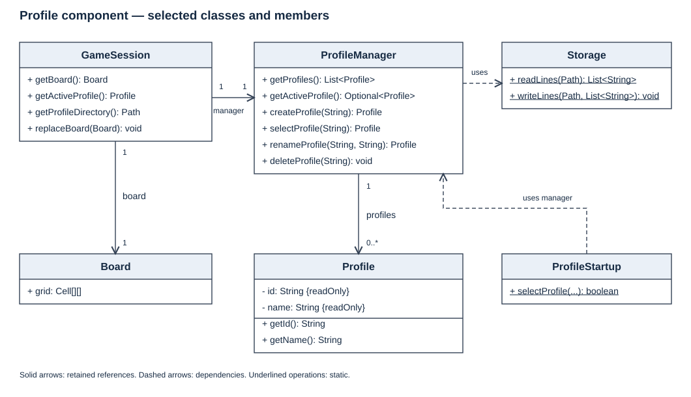
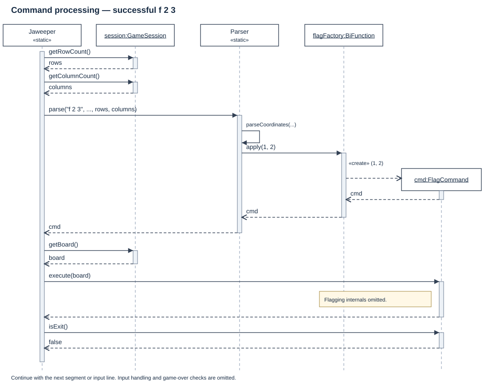
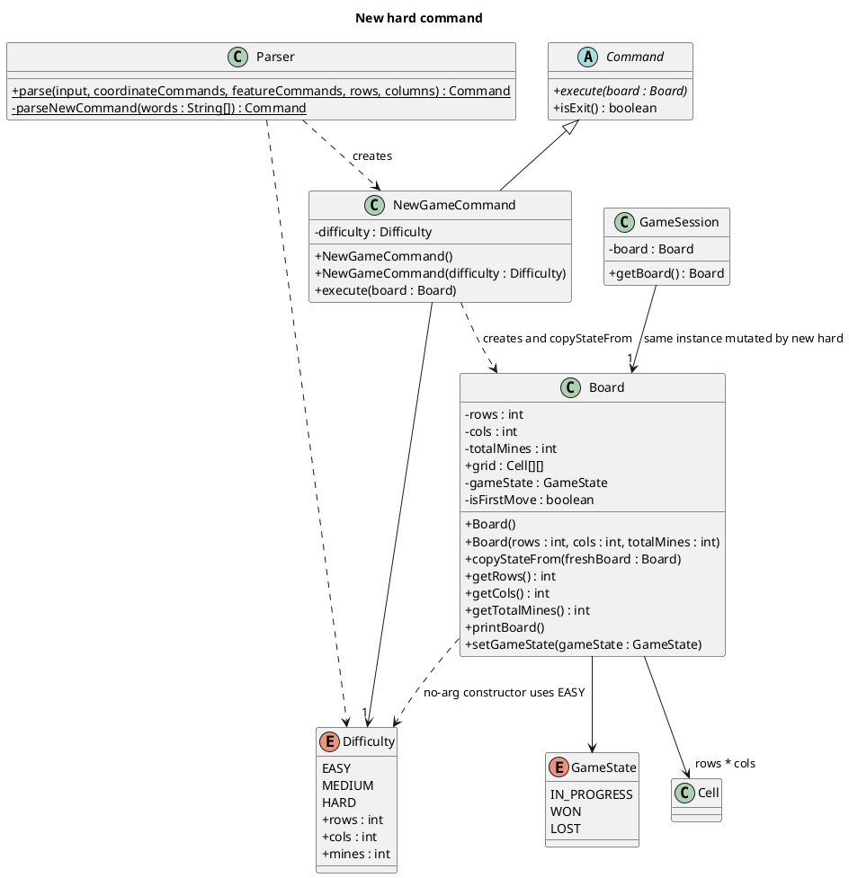
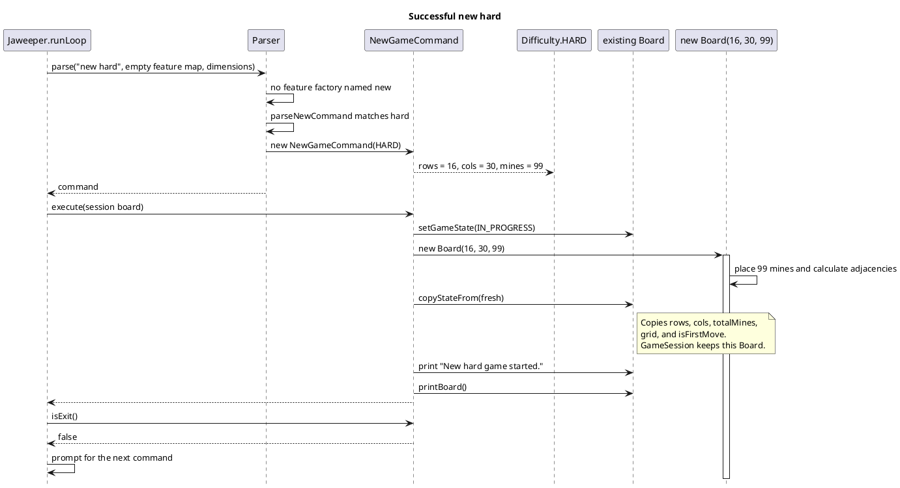

# Developer Guide

## Acknowledgements

{list here sources of all reused/adapted ideas, code, documentation, and third-party libraries -- include links to the original source as well}

## Design & implementation

### Command processing and profile sessions

**Maintainer:** Zack (zackyesten).
**Implementation baseline:** the foundation and runtime integration merged in [PR #34](https://github.com/AY2627S1-CS2113-W10-4/tp/pull/34).

This section explains how Jaweeper selects a local player, turns text input into commands, and gives commands access to the same current board and profile. It documents the implemented foundation, not the complete planned v2.0 feature set. In-game profile management commands, save/load, statistics and progress-loss confirmation are not provided by this foundation.

#### Architecture and responsibilities

The implementation separates input coordination, command construction, shared state and file access. These are logical responsibilities within the same Java package, not separate processes or independently deployed components.

| Responsibility | Main classes | Boundary |
|---|---|---|
| Application startup and execution | `Jaweeper`, `ProfileStartup` | Own the input loop and startup selection; delegate feature logic to commands. |
| Input interpretation | `Parser` | Validate syntax and coordinates, then construct a command without executing it. |
| Shared runtime state | `GameSession` | Hold the current `Board` and one shared `ProfileManager`. |
| Profile management | `ProfileManager`, `Profile` | Maintain stable player identities, the registry and the session-only active selection. |
| Text persistence | `Storage` | Read/write UTF-8 text; do not interpret saved games or calculate statistics. |

`Jaweeper.main` creates a `ProfileManager` using the working-directory-relative path `data`. Only after startup selection succeeds does it create the initial board and `GameSession`. The session-aware `run` method then delegates to the common execution loop. The older `run(Scanner, Board, ...)` overload remains available for existing tests and does not perform profile selection.

#### Profile component structure

*Figure 1. Selected members and relationships of the profile component. Solid directed associations denote retained references; dashed dependencies denote use. ProfileStartup and Storage expose static operations. Multiplicities show one manager and one current board per session, and zero or more profiles in the registry. This is a focused diagram, not the complete application class model.*

A `Profile` is immutable: its ID and name are final. Renaming replaces the profile object in the manager's map while preserving its UUID. The active selection stores the ID rather than an old object reference, so subsequent lookups obtain the renamed profile. Consumers should similarly obtain the current profile when needed instead of caching an old display-name object.

`GameSession` holds one replaceable board reference. Following `replaceBoard(validatedBoard)`, the next command receives the replacement through `getBoard()`. Replacement itself does not validate saved-game contents, handle unsaved progress or update timers. Those operations remain the responsibility of the calling feature.

#### Startup selection and profile persistence

At the startup prompt, `create NAME` creates and explicitly selects a profile; `select NUMBER` selects an entry from the displayed list. The displayed number is a temporary user-facing index, not the persistent identity. `exit` or end-of-input cancels startup before a board is created. Invalid choices are reported and the prompt repeats.

`ProfileManager.createProfile` alone does not select its result. Keeping these operations separate lets another caller create a profile without changing the current player. Startup deliberately performs both operations. Active selection is not written to disk, so the next launch prompts again.

The registry is a human-readable UTF-8 file, `data/profiles.txt`. Its first line is `profiles-v1`; each following line contains a canonical UUID, a tab, and a display name. Names are trimmed, must contain 1–30 permitted characters, and must start with a letter or digit. Unicode letters/digits, spaces, underscores and hyphens are allowed; tabs and line breaks are not. Name uniqueness ignores case.

A missing registry means first-time use. An existing empty file, invalid header, malformed record, duplicate ID or duplicate name is instead an error. Startup must not silently replace such a file with an empty registry. Permission and other read errors are also reported, rather than interpreted as "no profiles".

For a registry change, the manager builds a candidate map, serializes it, and calls `Storage.writeLines` before replacing its in-memory map. Storage creates parent directories and writes a temporary file alongside the target, then attempts an atomic replacement. A non-atomic replacement is used if atomic moves are unsupported. This reduces exposure to partially written files but is not a universal crash-recovery guarantee or a multi-process transaction system.

A player's feature data belongs under `data/profiles/<UUID>/`. Changing a display name does not change this path. The directory accessor does not create it; a subsequent storage write creates parents as needed. The foundation's delete operation rejects the active profile and removes only an inactive profile's registry record. Associated feature files are retained. A future deletion UI must explain that behaviour rather than claim all data was erased.

#### Command parsing and execution

For each input line, the session-aware loop reads the current board dimensions and passes them to `Parser.parse`. Command names are lowercased with `Locale.ROOT`; argument case is preserved.

Dispatch follows this order:

1. If a matching lowercase key exists in the feature registry, invoke its `Function<String[], Command>` factory with the argument tokens, excluding the command name.
2. Otherwise, handle built-in `help`, `exit`, `new` and `board`. `help`, `exit` and `board` reject extra arguments. `new` accepts an optional difficulty word, described under [Difficulty levels and dynamic boards](#difficulty-levels-and-dynamic-boards).
3. For `r`, `f` and `u`, validate two integer coordinates against separate row/column limits, convert from one-based input to zero-based indices, and invoke the registered coordinate factory.

Unknown commands and invalid arguments produce `IllegalArgumentException` messages. The loop displays the message and continues. Factories construct commands; they must not mutate gameplay or perform persistence as a parsing side effect.

*Figure 2. Successful processing of `f 2 3`. The board has at least two rows and three columns. Scanner calls, logging, lambda adapters and the internals of flagging are omitted to keep the diagram focused. The call to parse represents the invocation through the loop's parsing function. Dashed arrows are returns; the command instance begins at its creation message.*

The parser converts the coordinates to `(1, 2)` before calling the flag factory. It returns the resulting command to the loop, which obtains the current board immediately before `execute(board)`. After successful execution, the loop checks `isExit()`. A false result continues the loop; a true result ends it. An `IllegalArgumentException` thrown during execution is also reported and the loop continues, but the loop does not roll back any mutations already made by that command.

Existing commands keep the `Command.execute(Board)` contract. A feature that also needs profiles can accept `GameSession` in its constructor. Registration in `Jaweeper.createFeatureCommands(session)` supplies that same session to its factory. `hint` is registered there and does not replace a built-in command.

Feature registrations take precedence over built-ins. For example, registering `new` would take over both `new easy` and plain `new`, so its factory must define both cases. Whitespace tokenization currently does not implement quoting or semicolon-separated command chains.

#### Defensive checks and error boundaries

User input is checked with ordinary conditionals and exceptions, not assertions. For example, invalid coordinate text is rejected even when Java assertions are disabled. Assertions instead document internal invariants, including validated coordinate bounds and non-null results from command factories. Gradle's test and run tasks enable assertions; a direct JAR launch can use `java -ea -jar jaweeper.jar`.

Session/profile preconditions also have distinct meanings: `ProfileManager.getActiveProfile()` returns an `Optional`, while `GameSession.getActiveProfile()` throws `IllegalStateException` if startup selection was omitted. Session construction and board replacement reject null references.

The application logs session start/end at INFO and command dispatch/rejected input at FINE. It does not log complete user command lines for these dispatch messages. Startup registry read failures are reported without replacing the registry. Because `execute(Board)` does not declare checked I/O exceptions, future file-based commands must handle their own `IOException` and must not report success after a failed write.

EOF currently ends the game loop directly; it does not execute an exit command. Therefore, a future override of `exit` alone will not implement EOF progress-loss handling.

#### Design decisions and alternatives

| Decision | Alternative considered | Reason and trade-off |
|---|---|---|
| Stable UUID identity, separate from display name | Use the name as a filename/key | Renames do not break save/statistics references; IDs are less convenient for users, so startup displays numbered names. |
| Pass one GameSession to feature commands | Static global state or a new manager per command | Explicit sharing is easier to isolate in tests and avoids independent active selections; constructors need an extra dependency. |
| Preserve execute(Board) and add feature factories | Rewrite every command to accept a new context | Existing commands/tests remain compatible; profile-aware commands carry session state in addition to receiving the board. |
| Save a candidate registry before replacing the in-memory map | Mutate the map and then write | A failed write does not make memory claim that a registry update succeeded; replacement requires a temporary copy. |
| Generic text storage | One storage class owning profiles, boards and statistics | Each owner controls their format without expanding one shared class; each feature must supply its own validation and error policy. |

#### Verification and remaining work

The automated tests separate parser behaviour, startup interaction and file-system state:

- `CoreCommandsTest` and `GameplayRoutingTest` cover the existing command routes and zero-based coordinate conversion.
- `ParserAssertionsTest` checks enabled assertions, a null command-factory result, and invalid-input exceptions.
- `ProfileStorageTest` uses JUnit temporary directories to exercise persistence, duplicate names, malformed registries, retained feature files and failed-write behaviour.
- `ProfileRuntimeTest` covers startup creation/selection, cancellation, recovery from invalid input, shared session access, feature overrides, rectangular coordinate limits and board replacement.

Run `./gradlew clean build` (Windows: `.\gradlew.bat clean build`) before submitting changes. The rectangular routing test checks the parser/session adapter; it is not evidence that all Board algorithms already support rectangular games.

This foundation does not yet supply in-game profile create/select/rename/delete commands, deletion confirmations, unsaved-game protection, saved-game restoration or statistics updates. Difficulty presets and `hint` are described in the next section. The session loop reads the current board's row and column counts through `GameSession`. Legacy `Parser.parse` overloads validate coordinates against the easy preset. Later features must update the relevant integration points and their documentation when behaviour changes.

See [the integration contract](ProfileIntegration.md) for the factory interface and ownership boundaries. Other team members should add their own implementation sections alongside this one.

### Difficulty levels and dynamic boards

**Maintainer:** Pranav (ProNoob116).

A game is no longer fixed at 9×9 with 10 mines. `Board` stores `rows`, `cols` and `totalMines`, and mine placement, adjacency counts, flood fill, victory checking and printing all use those values. The public `Board.SIZE` and `Board.MINES` constants remain only so existing tests can still describe the easy board. New code should use `getRows()`, `getCols()` and `getTotalMines()`.

`Difficulty` holds the three presets:

| Preset | Command | Rows | Columns | Mines |
|---|---|---|---|---|
| `EASY` | `new` or `new easy` | 9 | 9 | 10 |
| `MEDIUM` | `new medium` | 16 | 16 | 40 |
| `HARD` | `new hard` | 16 | 30 | 99 |

The no-argument `Board` constructor delegates to `Difficulty.EASY`. `new` with no difficulty word does the same.

#### Class structure

`Parser` recognises the difficulty word and constructs a `NewGameCommand`. That command stores one `Difficulty` and, on execution, builds a sized `Board`, then copies the new grid into the board object the session already holds. `GameSession` therefore keeps the same `Board` reference. The next command sees the new dimensions through `getRowCount()` and `getColumnCount()`, which read `grid.length` and `grid[0].length`.

*Figure 3. Classes involved in `new hard`. The source file is [diagrams/new-hard-class-diagram.puml](diagrams/new-hard-class-diagram.puml). Solid arrows are retained associations. Dashed arrows are use. `GameSession` keeps one `Board`; `new hard` changes that object instead of replacing the session's reference.*

#### Processing `new hard`

`new hard` is a built-in command, not a feature-factory command. The loop still passes the current dimensions into `Parser.parse`, but those dimensions are used only for `r`, `f` and `u`. They do not choose the size of the new game.

1. The feature map is checked first. There is no factory named `new`, so parsing continues to the built-in switch. A teammate who later registers `new` takes over `new hard` as well and must handle the difficulty word in that factory.
2. `parseNewCommand` accepts either one token (`new`) or two tokens. The second token is lowercased with `Locale.ROOT`. `hard` selects `Difficulty.HARD` and returns `new NewGameCommand(Difficulty.HARD)`. Any other word, or a third token, throws `IllegalArgumentException` with `Usage: new [easy|medium|hard]`. The loop prints that message and does not change the board.
3. `execute` sets the existing board's state to `GameState.IN_PROGRESS`, then constructs `new Board(16, 30, 99)`. That constructor allocates the grid, places 99 mines and calculates adjacencies. The first reveal on this board is still protected by the existing safe-first-click behaviour.
4. `copyStateFrom` copies `rows`, `cols`, `totalMines`, `grid` and `isFirstMove` into the session's board. It does not call `GameSession.replaceBoard`.
5. The command prints `New hard game started.` and `printBoard()`. The header reports `Remaining Mines: 99`, and the grid is labelled through row 16 and column 30.
6. `isExit()` is false, so the loop prompts again. Later coordinate commands are checked against the new grid size.

*Figure 4. Successful processing of `new hard`. The source file is [diagrams/new-hard-sequence-diagram.puml](diagrams/new-hard-sequence-diagram.puml). Scanner reads, logging and the mine-placement loops are omitted. Dashed arrows are returns.*

`new easy` and a bare `new` follow the same path with `Difficulty.EASY` and the message `New easy game started.` `new medium` uses `Difficulty.MEDIUM` and prints `New medium game started.`

#### Hint command

`hint` is separate from difficulty selection. `Jaweeper.createFeatureCommands` registers it under the lowercase name `hint`, so the feature factory runs before the built-in switch and the command cannot be confused with `new`. `HintCommand.create` rejects extra arguments with `Usage: hint`.

`execute` does not change the board. If the game is already over, it prints `The game is over. Type 'new' to start a new game.` Otherwise it scans revealed safe cells. When a cell's adjacent flag count equals its number, every hidden unflagged neighbour is treated as safe, and the command prints the first such cell in one-based coordinates, for example `Try revealing cell (4, 7).` If no such cell exists, it prints `No safe cell can be deduced yet. Reveal more cells.` An empty, ragged or incomplete grid throws `IllegalArgumentException`; the command catches it, prints the message and returns, so the input loop continues. Assertions check that a chosen hint is inside the current dimensions and refers to a hidden, unflagged cell. They do not claim the cell is free of a mine, because that depends on the player's flags being correct.

## Product scope
### Target user profile

{Describe the target user profile}

### Value proposition

{Describe the value proposition: what problem does it solve?}

## User Stories

|Version| As a ... | I want to ... | So that I can ...|
|--------|----------|---------------|------------------|
|v1.0|new user|see usage instructions|refer to them when I forget how to use the application|
|v2.0|user|find a to-do item by name|locate a to-do without having to go through the entire list|

## Non-Functional Requirements

{Give non-functional requirements}

## Glossary

* *glossary item* - Definition

## Instructions for manual testing

{Give instructions on how to do a manual product testing e.g., how to load sample data to be used for testing}
