# Jaweeper Developer Guide

* Table of Contents
  * [Acknowledgements](#acknowledgements)
  * [Setting up, getting started](#setting-up-getting-started)
  * [Design](#design)
  * [Implementation](#implementation)
  * [Documentation, logging, testing, dev-ops](#documentation-logging-testing-dev-ops)
  * [Appendix: Requirements](#appendix-requirements)
  * [Appendix: Instructions for manual testing](#appendix-instructions-for-manual-testing)

--------------------------------------------------------------------------------------------------------------------

## Acknowledgements

* This project is based on the [NUS CS2113 tP template](https://github.com/NUS-CS2113-AY2627-S1/tp).
* The structure of this guide follows the [AddressBook-Level3 Developer Guide](https://se-education.org/addressbook-level3/DeveloperGuide.html).
* Libraries and tools used: [JUnit 5](https://junit.org/), [Gradle](https://gradle.org/) with the [Shadow plugin](https://gradleup.com/shadow/), [Checkstyle](https://checkstyle.org/) and [PlantUML](https://plantuml.com/).

--------------------------------------------------------------------------------------------------------------------

## Setting up, getting started

1. Install **JDK 25** and Git, then clone the repository.
1. Open the root folder as a Gradle project in your IDE. Use the committed Gradle wrapper.
1. Run `./gradlew check shadowJar` (`.\gradlew.bat check shadowJar` on Windows). This runs the tests and Checkstyle, and builds `build/libs/jaweeper.jar`.
1. Run `java -ea -jar build/libs/jaweeper.jar`. The `-ea` flag enables assertions.

--------------------------------------------------------------------------------------------------------------------

## Design

> **Tip:** The `.puml` files used to create the diagrams in this document are in the [`docs/diagrams`](https://github.com/AY2627S1-CS2113-W10-4/tp/tree/master/docs/diagrams) folder. Every diagram includes `style.puml` so that all diagrams share one style. To update a diagram, edit its `.puml` file and render it into `docs/images/`, e.g. `java -jar plantuml.jar -tpng -o ../images docs/diagrams/Undo.puml`.

### Architecture

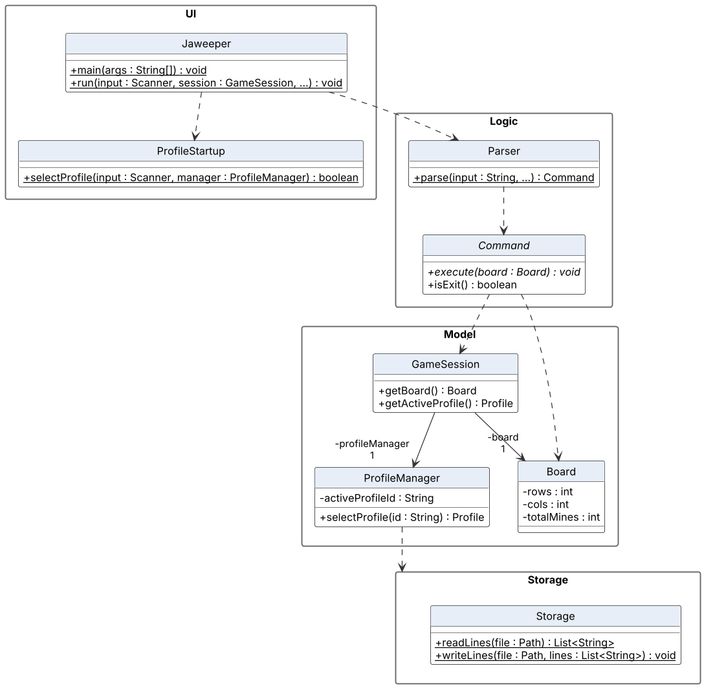

The ***Architecture Diagram*** given above explains the high-level design of Jaweeper.

Given below is a quick overview of the main components and how they interact with each other.

**Main components of the architecture**

**`Jaweeper`** (in the UI component) is in charge of the app launch and the input loop.
* At app launch, it opens the profile registry, asks the player to choose a profile, and creates the shared `GameSession`.
* It then reads commands until the player exits.

The rest of the app consists of four components.

* [**`UI`**](#ui-component): Reads user input and shows output in the terminal.
* [**`Logic`**](#logic-component): Turns input into commands and executes them.
* [**`Model`**](#model-component): Holds the data of the app in memory.
* [**`Storage`**](#storage-component): Reads data from, and writes data to, text files.

[**`Commons`**](#common-classes) represents a collection of classes used by multiple other components.

**How the architecture components interact with each other**

The *Sequence Diagram* below shows how the components interact with each other for the scenario where the user issues the command `save trip`.

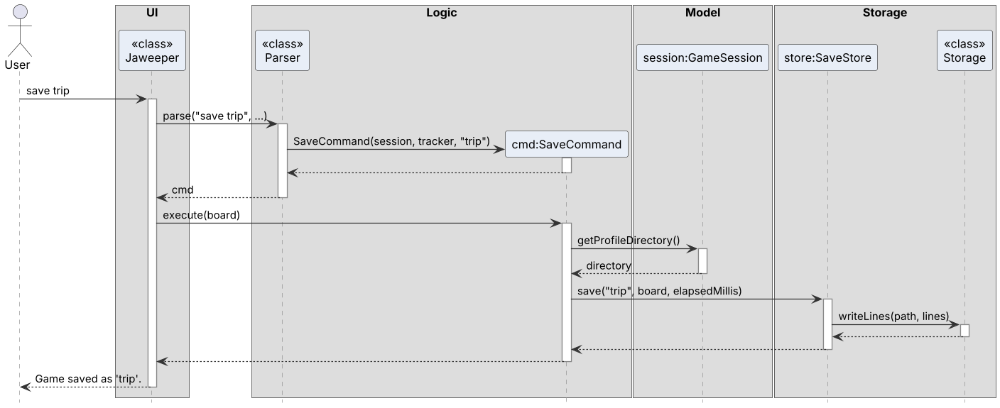

Every command follows the same pattern: `Parser` creates a `Command`, and the command's `execute(Board)` uses the `Model` and, if needed, `Storage`. Commands get everything other than the board (the session, the save tracker) through their constructors.

### UI component

**API** : [`Jaweeper.java`](https://github.com/AY2627S1-CS2113-W10-4/tp/blob/master/src/main/java/seedu/jaweeper/Jaweeper.java), [`ProfileStartup.java`](https://github.com/AY2627S1-CS2113-W10-4/tp/blob/master/src/main/java/seedu/jaweeper/ProfileStartup.java)

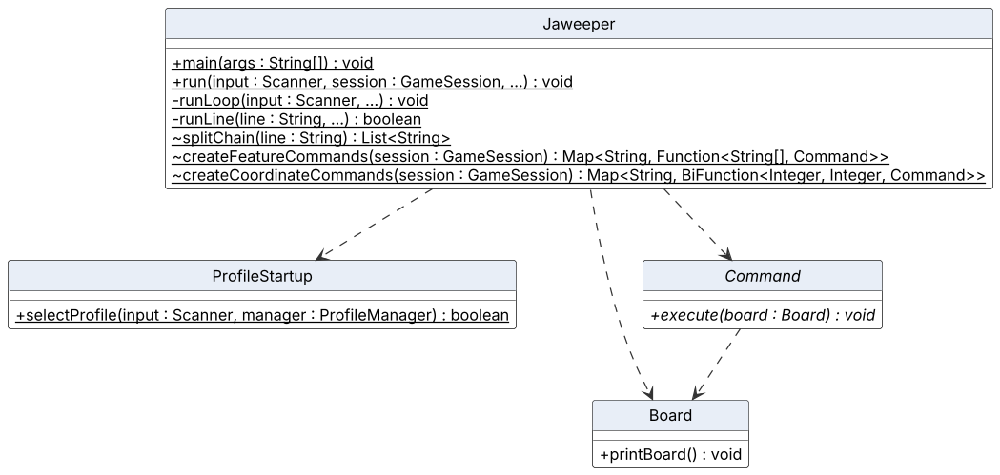

The UI component,

* asks the player to `create NAME` or `select NUMBER` a profile at launch (`ProfileStartup`).
* reads one line at a time, splits it on `;`, and passes each part to the `Logic` component (`Jaweeper.runLine`).
* prints any error message from a rejected command and keeps the loop running.
* shows the board through `Board.printBoard()`, which commands call after changing the board.

### Logic component

**API** : [`Parser.java`](https://github.com/AY2627S1-CS2113-W10-4/tp/blob/master/src/main/java/seedu/jaweeper/Parser.java), [`Command.java`](https://github.com/AY2627S1-CS2113-W10-4/tp/blob/master/src/main/java/seedu/jaweeper/Command.java)

Here's a (partial) class diagram of the `Logic` component:

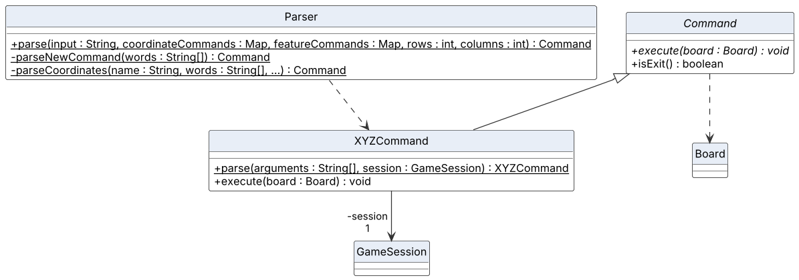

`XYZCommand` is a placeholder for a specific command such as `SaveCommand` or `FlagCommand`.

How the `Logic` component works:

1. `Parser.parse` lowercases the command word and looks for a **feature factory** registered in `Jaweeper.createFeatureCommands(session)`.
1. If there is none, it handles the built-in commands `help`, `exit`, `new` and `board`, and finally `r`, `f` and `u`, whose coordinates are checked against the current board size and converted to zero-based values.
1. The factory validates the arguments and returns a `Command` object. It does not change the game.
1. `Jaweeper` calls `execute(board)` on the command, then `isExit()` to decide whether to stop.

> **Note:** Any `IllegalArgumentException` thrown while parsing or executing is printed, and the loop continues. To add a command, create a `Command` subclass with a static `parse(String[] arguments, GameSession session)` and register it in `Jaweeper.createFeatureCommands(session)`, reusing the existing `session`.

### Model component

**API** : [`GameSession.java`](https://github.com/AY2627S1-CS2113-W10-4/tp/blob/master/src/main/java/seedu/jaweeper/GameSession.java)

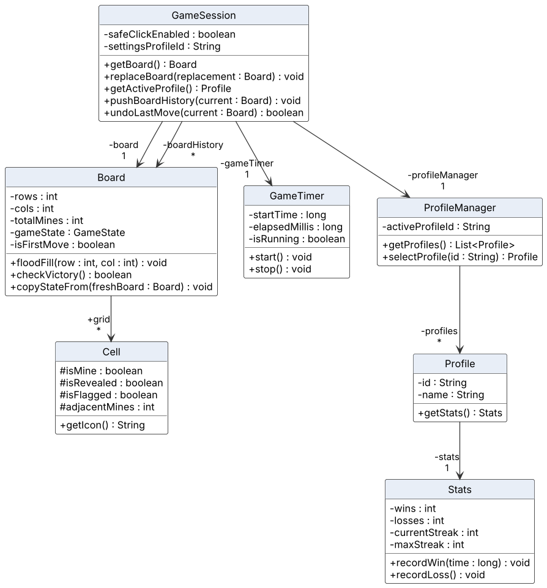

The `Model` component,

* stores the current game as a `Board` of `Cell` objects, together with the undo history (`boardHistory`) and the `GameTimer`.
* stores all local players in the `ProfileManager`, which keeps `Profile` objects in creation order and remembers the active one.
* stores each player's results in a `Stats` object. Statistics are kept in memory only.
* caches the active player's safeclick setting in `GameSession`.

### Storage component

**API** : [`Storage.java`](https://github.com/AY2627S1-CS2113-W10-4/tp/blob/master/src/main/java/seedu/jaweeper/Storage.java)

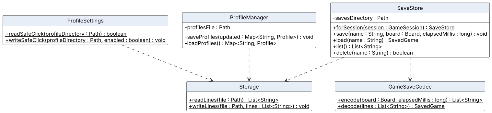

The `Storage` component,

* reads and writes UTF-8 text files through `Storage`. `writeLines` writes a temporary file first and then moves it into place.
* saves the profile registry to `data/profiles.txt` (`ProfileManager`).
* saves each player's settings to `data/profiles/<UUID>/settings.txt` (`ProfileSettings`).
* saves each player's games to `data/profiles/<UUID>/saves/<name>.txt` (`SaveStore`, `GameSaveCodec`).

### Common classes

Classes used by multiple components are in the `seedu.jaweeper` package. Examples are `Difficulty` (the board presets), `GameState` (`IN_PROGRESS`, `WON`, `LOST`) and `SaveFileException`.

--------------------------------------------------------------------------------------------------------------------

## Implementation

This section describes some noteworthy details on how certain features are implemented. Each feature has a class diagram, an object diagram and a sequence diagram. Logging is omitted from all sequence diagrams.

### Flagging a cell

Flagging a cell (`f ROW COL`) is used here to show how any coordinate command is parsed and executed. Unflagging (`u`) and revealing (`r`) follow the same path.

The class diagram below shows the classes involved.

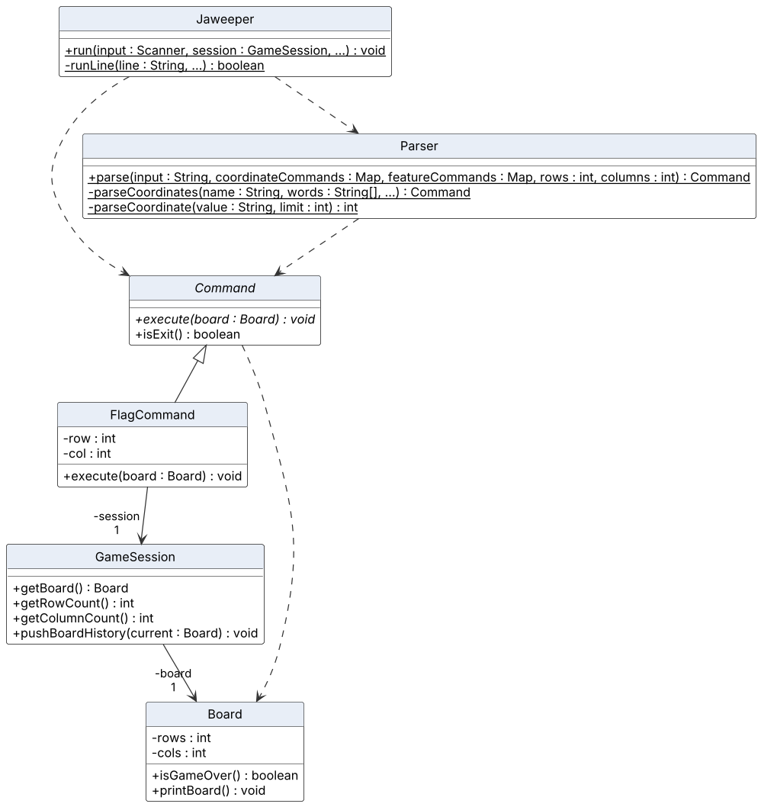

Given below is an example usage scenario and how the mechanism behaves at each step.

Step 1. The player types `f 2 3` on a 9×9 board. `Jaweeper.runLine` reads the current board size from the session and calls `Parser.parse("f 2 3", ..., 9, 9)`.

Step 2. `parseCoordinates` checks that there are two integers from 1 to 9, converts them to the zero-based `1, 2`, and calls the registered coordinate factory, which constructs `FlagCommand(session, 1, 2)`.

Step 3. `Jaweeper` calls `execute(board)`. The command first pushes a copy of the board onto the session's undo history, then flags the cell and prints the board.

The sequence diagram below shows Steps 1 to 3.

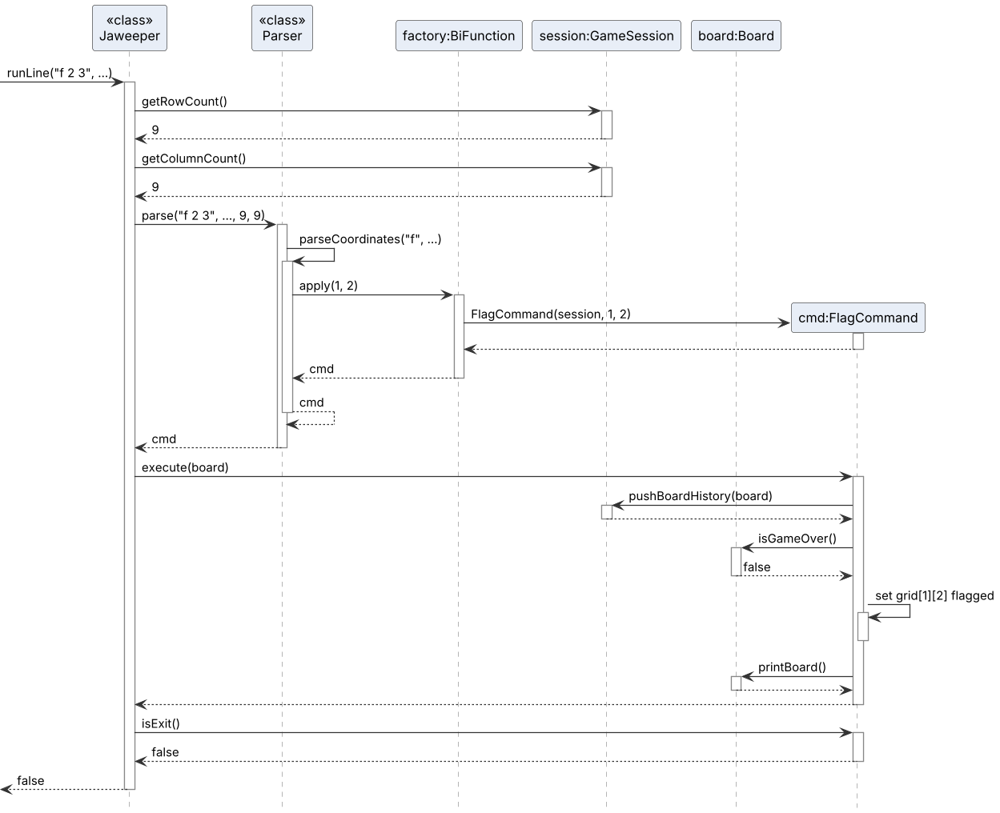

The object diagram below shows the objects just after Step 3. The copy (`before`) still has `grid[1][2]` unflagged.

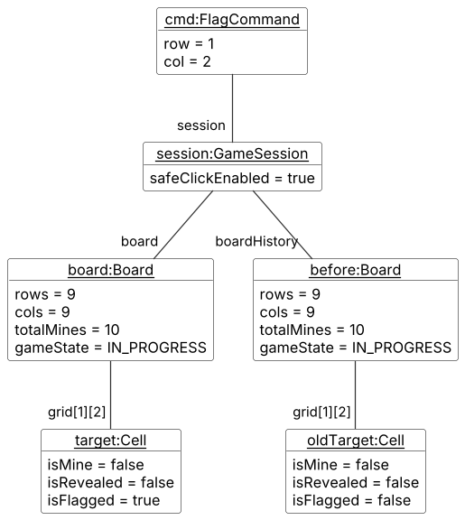

> **Note:** `FlagCommand` rejects the move, printing a message, if the game is over or the cell is already revealed or flagged.

#### Design considerations:

**Aspect: Where arguments are validated**

* **Alternative 1 (current choice):** Factories validate and construct; `execute` changes state.
  * Pros: Nothing in the game changes until the whole command is known to be valid.
  * Cons: Each command needs a separate `parse` method.
* **Alternative 2:** Parse and execute in one step.
  * Pros: Fewer methods.
  * Cons: A badly formed command could change the game before the error is found.

### Switching profiles

A profile is a local player with a stable UUID, a display name and in-memory statistics. At launch, `ProfileStartup` asks the player to create or select one. During play, `profile list|create|select|rename|delete` is handled by `ProfileCommand`.

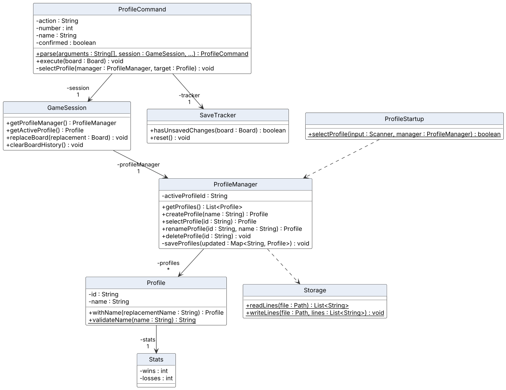

Every change to the registry goes through `ProfileManager.saveProfiles`, which writes `data/profiles.txt` **before** updating the in-memory map. `profiles.txt` starts with the header `profiles-v1`, followed by one `UUID<TAB>name` line per profile.

Given below is an example usage scenario of `profile select 2`.

Step 1. Zheng Yiting is playing, and Guest is profile 2. `ProfileCommand.execute` looks up profile 2 in the current list. The number is only a position in the list; the UUID is the real identity.

Step 2. If the target is already active, nothing happens. Otherwise `SaveTracker.hasUnsavedChanges` is checked. If there is unsaved progress, the switch is blocked with a message asking the player to save first.

Step 3. With no unsaved progress, a fresh easy `Board` is created, Guest is selected, and the session's board, undo history, timer and save tracking are all reset.

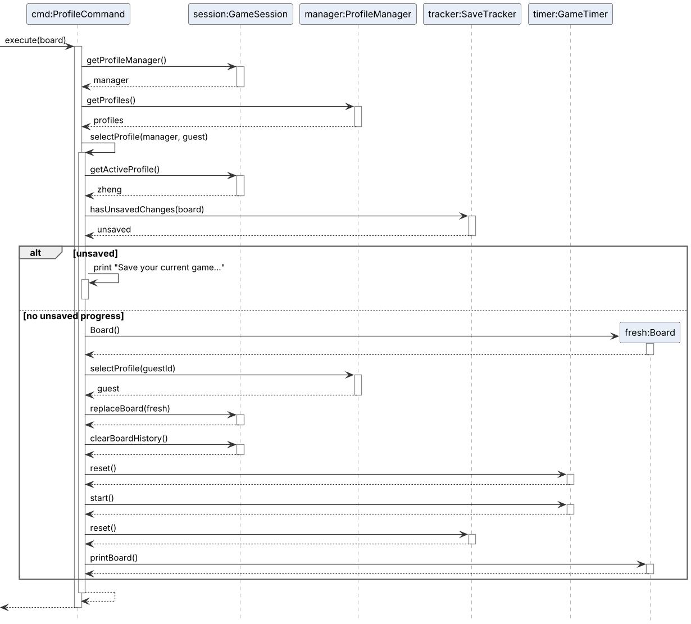

The object diagram below shows the objects after Step 3. Both profiles stay in the registry; only `activeProfileId` changed (UUIDs are shortened).

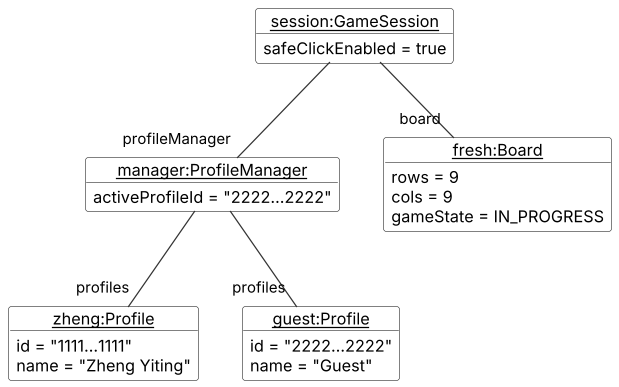

> **Note:** `profile create NAME` adds a profile without switching. `profile rename NUMBER NAME` keeps the UUID and the same `Stats` object. `profile delete NUMBER confirm` removes an inactive profile from the registry but keeps its files.

#### Design considerations:

**Aspect: What happens to an unfinished game when switching**

* **Alternative 1 (current choice):** Require the player to save first.
  * Pros: A game is never silently given to another player; simple to implement.
  * Cons: The player must type `save NAME` before switching.
* **Alternative 2:** Keep one board per profile in memory.
  * Pros: Switching back resumes instantly.
  * Cons: Needs a separate board, timer and undo history per profile.

**Aspect: How a profile's data folder is named**

* **Alternative 1 (current choice):** Use the profile's UUID.
  * Pros: Renaming a profile does not move its data.
  * Cons: Folder names are not human-readable.
* **Alternative 2:** Use the display name.
  * Pros: Easy to find a player's files.
  * Cons: Breaks when a profile is renamed.

### Creating a board

`new [easy|medium|hard]` starts a preset game and `new custom ROWS COLS MINES` starts a custom one. `EASY` is 9×9 with 10 mines, `MEDIUM` is 16×16 with 40, and `HARD` is 16×30 with 99.


`Board` stores its own `rows`, `cols` and `totalMines`, so all board logic works for any size. `CustomGameCommand.validate` accepts dimensions from 5 to 50 and a mine count from 1 to cells − 1.

Given below is an example usage scenario of `new hard`.

Step 1. The `new` factory receives `["hard"]` and constructs `NewGameCommand(session, HARD)`. Any other word throws `Usage: new [easy|medium|hard]` and the current board is kept.

Step 2. `execute` builds `Board(16, 30, 99)`, which places 99 mines at random and counts adjacent mines.

Step 3. `copyStateFrom` copies the size, cells, state and first-move flag into the board the session already holds. The timer restarts and the new board is printed.


The object diagram below shows the objects just after `copyStateFrom`. `copied` and `original` are different `Cell` objects with the same values.


> **Note:** `new custom R C M` follows the same steps through `CustomGameCommand` and also clears the undo history. The first reveal of either board is protected by [safeclick](#changing-the-safeclick-setting).

#### Design considerations:

**Aspect: How the new board is installed**

* **Alternative 1 (current choice):** Copy the new board's state into the existing `Board` object.
  * Pros: Every holder of the board reference sees the new game.
  * Cons: Builds a temporary second board.
* **Alternative 2:** Replace the session's board with `replaceBoard`.
  * Pros: No copying.
  * Cons: Any object still holding the old reference would see a stale board.

### Undoing a move

`undo` restores the board as it was before the last reveal, flag or unflag.


Given below is an example usage scenario and how the undo mechanism behaves at each step.

Step 1. The player flags one cell. Before flagging, `FlagCommand` calls `session.pushBoardHistory(board)`, which pushes `board.deepCopy()` onto `boardHistory`.

Step 2. The player flags a second cell. Another copy, now containing the first flag, is pushed.

Step 3. The player types `undo`. `undoLastMove` pops the top copy and copies it onto the live board with `copyStateFrom`.


The object diagram below shows the objects after Step 3. The second flag is gone, and the stack still holds the board from before the first flag. The timer keeps running.


> **Note:** If the history is empty, `undo` prints `Nothing to undo.` `new custom` and switching profiles clear the history. A preset `new` currently does not, so `undo` straight after it brings back the last board of the previous game.

#### Design considerations:

**Aspect: How undo states are stored**

* **Alternative 1 (current choice):** Save a full copy of the board before each move.
  * Pros: Easy to implement and always correct.
  * Cons: Uses more memory on large boards.
* **Alternative 2:** Each command knows how to undo itself.
  * Pros: Uses less memory.
  * Cons: Every command needs its own undo logic, which is easy to get wrong (e.g. flood fill).

### Getting a hint

`hint` names one hidden cell that the revealed numbers and flags prove to be safe. It never changes the board.

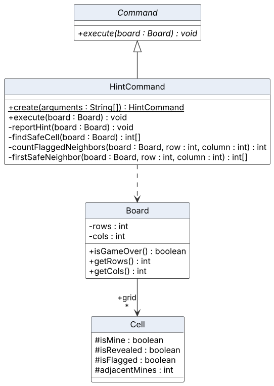

Given below is an example usage scenario.

Step 1. The top-left corner of the board is as shown in the object diagram below. `c00` is revealed with the number 1 and already has one flagged neighbour, `c01`.

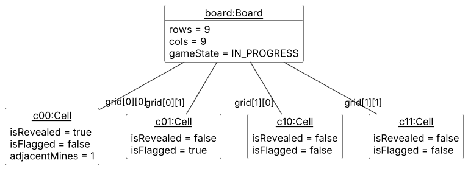

Step 2. The player types `hint`. `findSafeCell` scans revealed safe cells in row order. For `c00`, the number of flagged neighbours equals its number, so its other hidden neighbours must be safe.

Step 3. The first such neighbour, `c10`, is returned and `Try revealing cell (2, 1).` is printed.

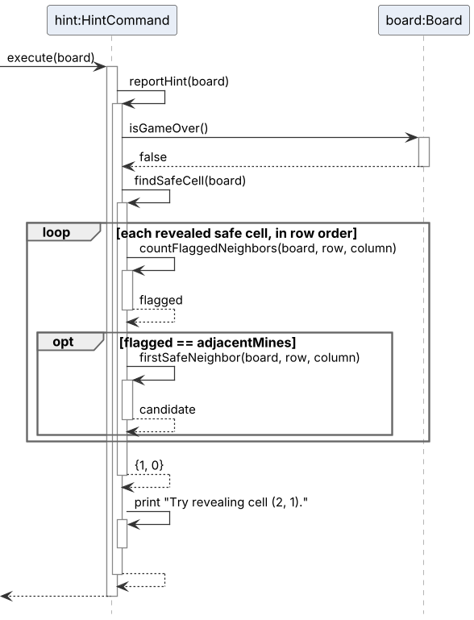

> **Note:** A hint assumes the player's flags are correct. If no cell qualifies, `No safe cell can be deduced yet. Reveal more cells.` is printed.

#### Design considerations:

**Aspect: How safe cells are deduced**

* **Alternative 1 (current choice):** Use only the single-cell rule (flags around a number equal the number).
  * Pros: Simple and fast.
  * Cons: Cannot find hints that need reasoning over several cells.
* **Alternative 2:** Solve constraints across the whole board.
  * Pros: Finds more hints.
  * Cons: Much more complex to implement and test.

### Recording a game result

When a reveal ends the game, the timer stops and the active profile's `Stats` are updated.

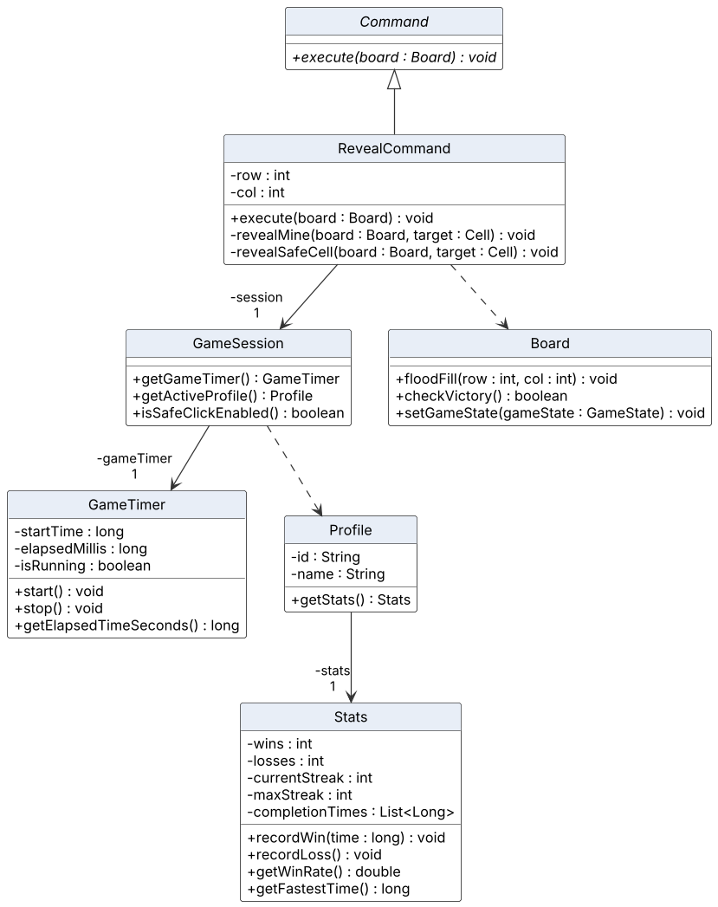

Given below is an example usage scenario.

Step 1. The player reveals a cell. If it is a mine, `revealMine` sets the state to `LOST`, stops the timer and calls `recordLoss()`, which resets the current streak.

Step 2. If it is safe, `revealSafeCell` flood-fills from the cell. If every safe cell is now revealed, the state becomes `WON`, the timer stops, and `recordWin(seconds)` increments wins and the streak and stores the time.

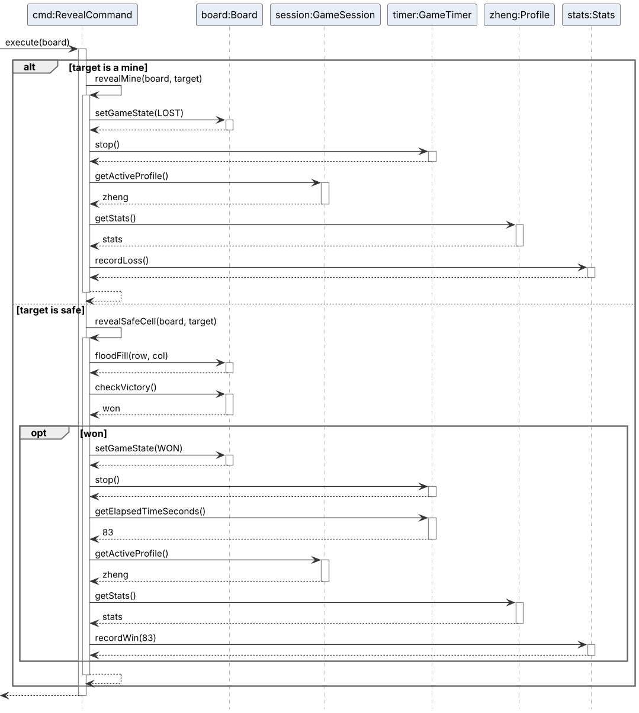

The object diagram below shows the objects after Zheng Yiting wins her third game in 83 seconds.

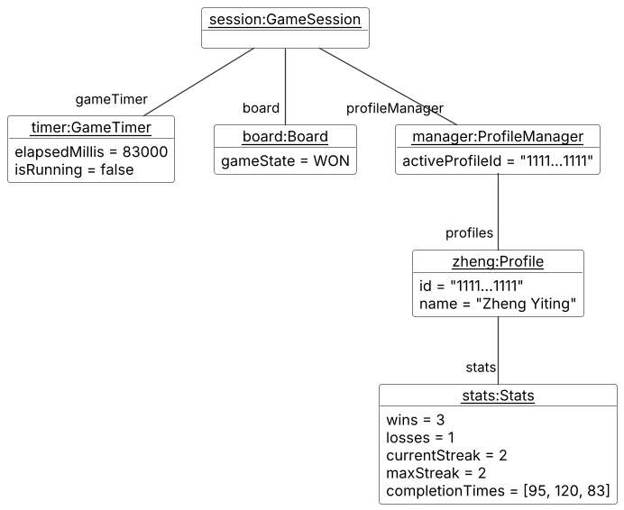

> **Note:** Statistics are kept in memory only and are lost when the app exits. `recordWin` is given seconds, but `StatsCommand` formats the fastest time as milliseconds, so it currently shows `00:00`.

#### Design considerations:

**Aspect: Where results are recorded**

* **Alternative 1 (current choice):** `RevealCommand` records the result when it ends the game.
  * Pros: The result is recorded exactly once, at the moment the game ends.
  * Cons: `RevealCommand` depends on `Stats` and `GameTimer`.
* **Alternative 2:** The input loop checks for a finished game after every command.
  * Pros: Commands stay simpler.
  * Cons: The loop must remember whether a result was already recorded.

### Viewing the leaderboard

`stats` shows the active profile's statistics, `stats clear` resets them, and `leaderboard` compares all profiles.

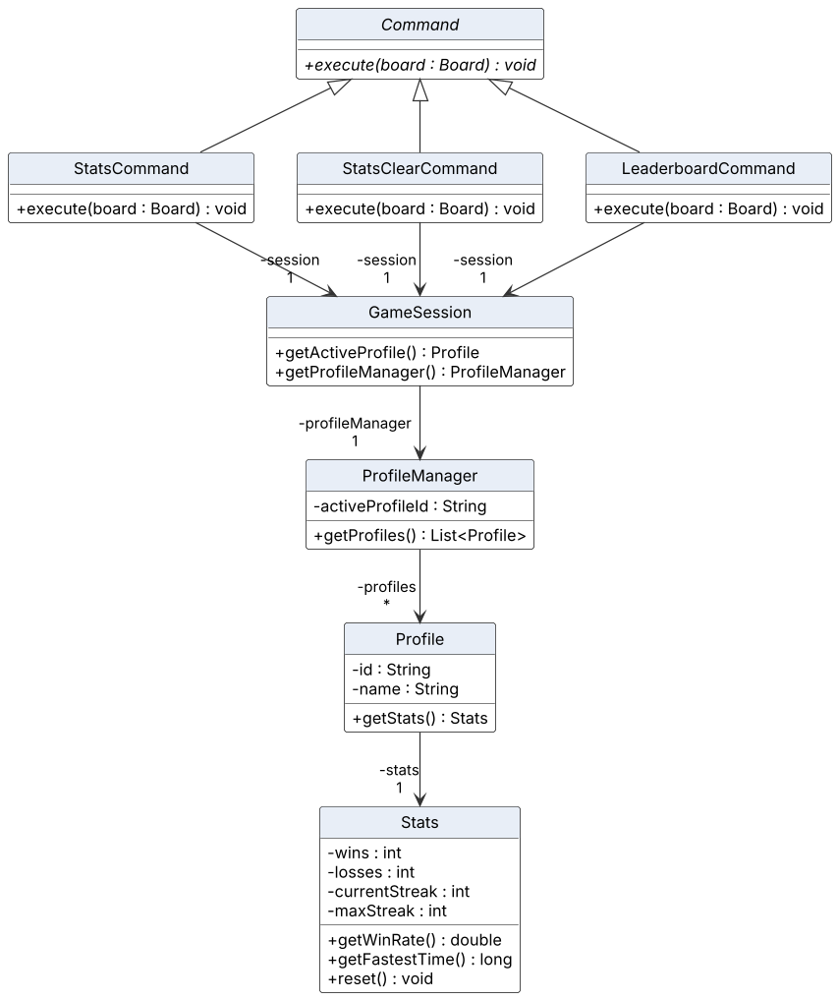

Given below is an example usage scenario of `leaderboard` with the two profiles in the object diagram below.

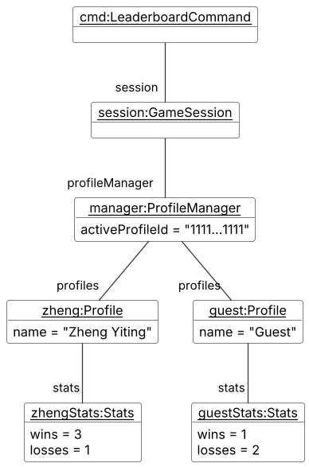

Step 1. The command copies the profile list from the `ProfileManager`, so it can be sorted without changing the registry.

Step 2. The list is sorted by wins, with win rate breaking ties.

Step 3. One row is printed per profile: rank, name, wins, losses and win rate.

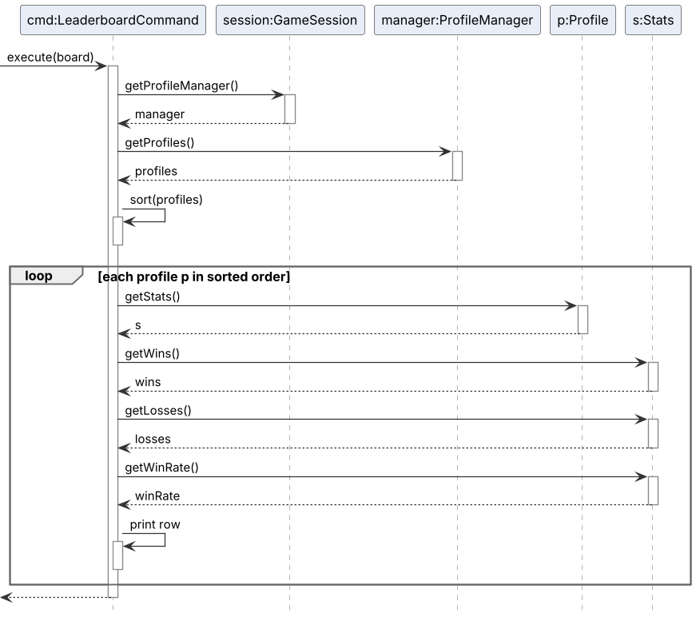

> **Note:** The comparator currently calls `reversed()` twice, so the profile with the fewest wins is listed first. It should be `comparingInt(wins).thenComparingDouble(winRate).reversed()`.

#### Design considerations:

**Aspect: Sorting the leaderboard**

* **Alternative 1 (current choice):** Sort a copy of the profile list each time.
  * Pros: The registry's creation order, used for profile numbers, is never changed.
  * Cons: Sorts on every call (negligible for a few local profiles).
* **Alternative 2:** Keep a sorted list updated after every game.
  * Pros: No sorting when displaying.
  * Cons: Must be kept in step with every win, loss and `stats clear`.

### Saving a game

`save NAME` writes the current unfinished game to a readable text file. Plain `save` re-saves to the name the game was last saved to or loaded from.

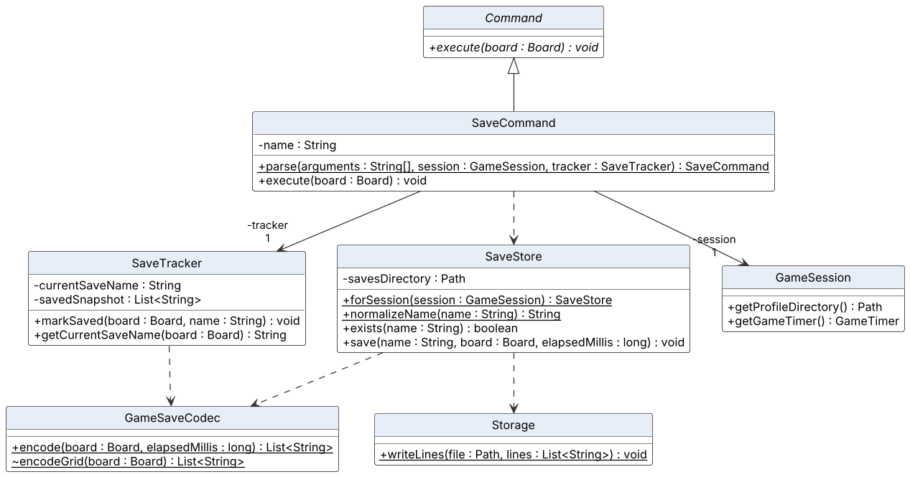

`SaveStore` owns save names and the folder `data/profiles/<UUID>/saves/`. `GameSaveCodec` converts a board and its elapsed time to file lines and back, and knows nothing about files. `SaveTracker` remembers the position at the last save or load.

Given below is an example usage scenario of `save trip`.

Step 1. `SaveCommand.parse` lowercases the name and allows only letters, digits, `_` and `-`, so a name can never contain `/` or `..`. Windows-reserved names such as `con` are rejected.

Step 2. `execute` refuses a finished game. Otherwise `SaveStore.save` asks `GameSaveCodec.encode` for the lines and writes them with `Storage.writeLines`.

Step 3. Only after a successful write does the command call `tracker.markSaved`. If the write fails, the game is not marked as saved, so `exit` still warns the player.


The object diagram below shows the objects after Step 3. The tracker refers to the **same** grid array as the board, and keeps the grid's rows as text. Comparing both later tells it whether the game has changed.

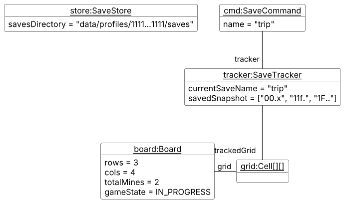

The save file is readable. For a 3×4 board:

```
jaweeper-save-v1
size 3 4
mines 2
elapsed-ms 52340
board
00.x
11f.
1F..
checksum 623d2492
```

`.` is a hidden safe cell, `x` a hidden mine, `f` a flag on a safe cell, `F` a flag on a mine, and `0`–`8` a revealed safe cell. The last line is a CRC32 checksum of all lines above it.

#### Design considerations:

**Aspect: Save file format**

* **Alternative 1 (current choice):** Readable text with a CRC32 checksum.
  * Pros: Easy to read while debugging; damage and hand edits are detected.
  * Cons: Not tamper-proof against someone who recomputes the checksum.
* **Alternative 2:** Java serialisation.
  * Pros: Less code.
  * Cons: Unreadable, and breaks when classes change.

### Loading a game

`load NAME` replaces the current game with a saved one and continues its timer.

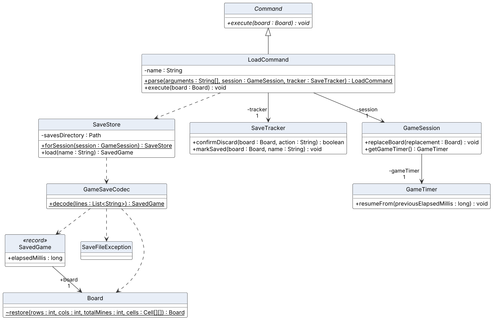

Given below is an example usage scenario of `load trip`.

Step 1. `SaveStore.load` reads the file and `GameSaveCodec.decode` validates every line. It throws `SaveFileException`, naming the line where possible, if the header is wrong, the checksum does not match, a number is malformed or out of range, a row has the wrong length or an unknown symbol, the mine count differs, a revealed number is wrong, or the game is already finished. The current game is then left unchanged.

Step 2. `SaveTracker.confirmDiscard` protects unsaved progress, as shown in the activity diagram below. The first request only prints a warning; repeating the **same** request with no move in between confirms it.


Step 3. Only then are the board replaced, the timer resumed and the tracker updated.


The object diagram below shows the objects after Step 3.

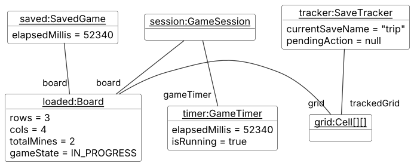

> **Note:** Ending input with Ctrl-D leaves the loop without the unsaved-progress warning.

#### Design considerations:

**Aspect: When the current game is replaced**

* **Alternative 1 (current choice):** Validate the whole file before replacing anything.
  * Pros: A bad file can never leave a half-loaded game.
  * Cons: Builds a second board in memory.
* **Alternative 2:** Load cell by cell into the live board.
  * Pros: Less memory.
  * Cons: An error part-way through corrupts the current game.

**Aspect: How unsaved progress is detected**

* **Alternative 1 (current choice):** Compare the board with a snapshot taken at the last save or load.
  * Pros: No changes to other commands; new commands are covered automatically.
  * Cons: One pass over the grid per check (negligible for boards up to 99×99).
* **Alternative 2:** A dirty flag set by every command that changes the board.
  * Pros: Constant-time check.
  * Cons: Every current and future command must remember to set it.

### Showing all mines after a loss

After a loss, the board shows every mine and marks wrong flags.

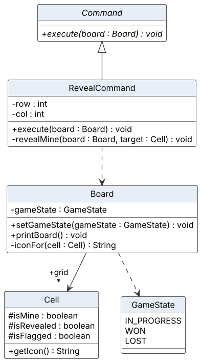

Given below is an example usage scenario.

Step 1. The player reveals a mine. `revealMine` sets the state to `LOST` before printing the board.

Step 2. While printing, `Board.iconFor` checks the state. Unflagged mines are drawn as `*` and flags on safe cells as `X`. Every other cell is drawn with `Cell.getIcon()`.

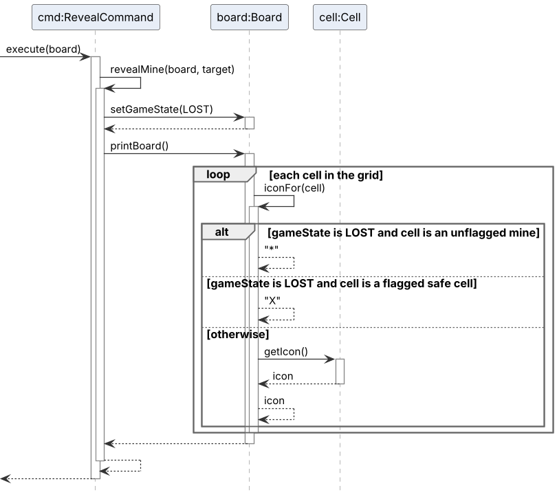

The object diagram below shows the four kinds of cell on a lost board. `hit` and `hidden` are drawn as `*`, `wrongFlag` as `X`, and `rightFlag` as `F`.

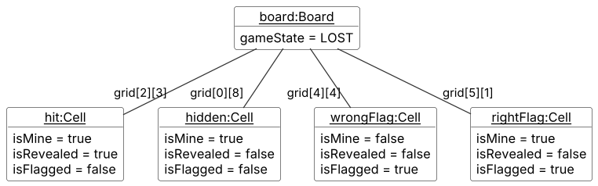

#### Design considerations:

**Aspect: How mines are shown**

* **Alternative 1 (current choice):** Choose the symbol in `printBoard` while the state is `LOST`.
  * Pros: No cell changes, so completion figures and statistics are unaffected.
  * Cons: The display rule lives in `Board` rather than `Cell`.
* **Alternative 2:** Set `isRevealed` on every mine.
  * Pros: `Cell.getIcon()` already draws revealed mines.
  * Cons: Changes the game data and cannot show wrong flags.

### Changing the safeclick setting

`settings safeclick on|off` decides whether the first reveal of a game is guaranteed to be safe. The value is saved per profile.

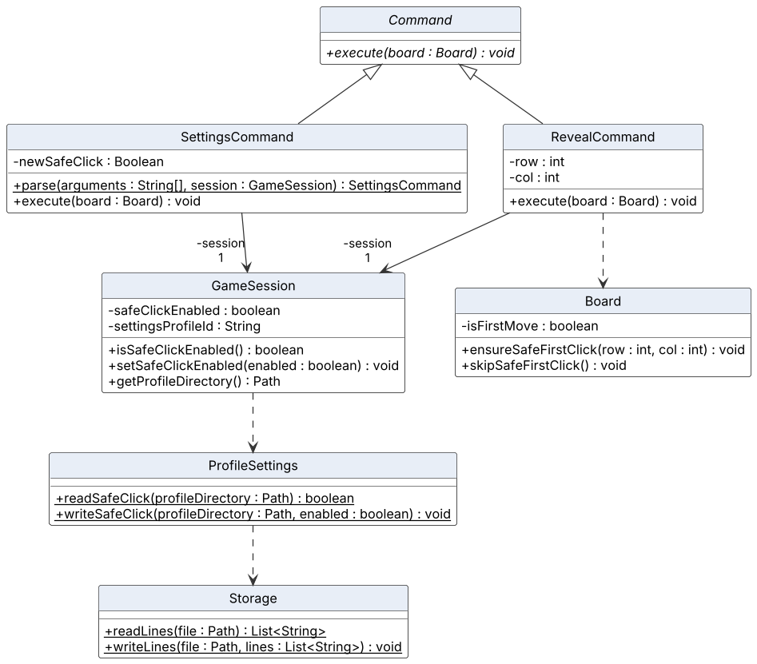

`ProfileSettings` reads and writes `data/profiles/<UUID>/settings.txt`, which holds the header `jaweeper-settings-v1` and the line `safeclick on` or `safeclick off`. `GameSession` caches the value together with the profile ID it belongs to.

Given below is an example usage scenario of `settings safeclick off`.

Step 1. `setSafeClickEnabled(false)` writes the file first. Only after it succeeds are the cached value and its profile ID updated. If the write fails, the error is printed and nothing changes.

Step 2. On the first reveal of the next game, `RevealCommand` calls `skipSafeFirstClick` instead of `ensureSafeFirstClick`, so the first reveal can hit a mine.

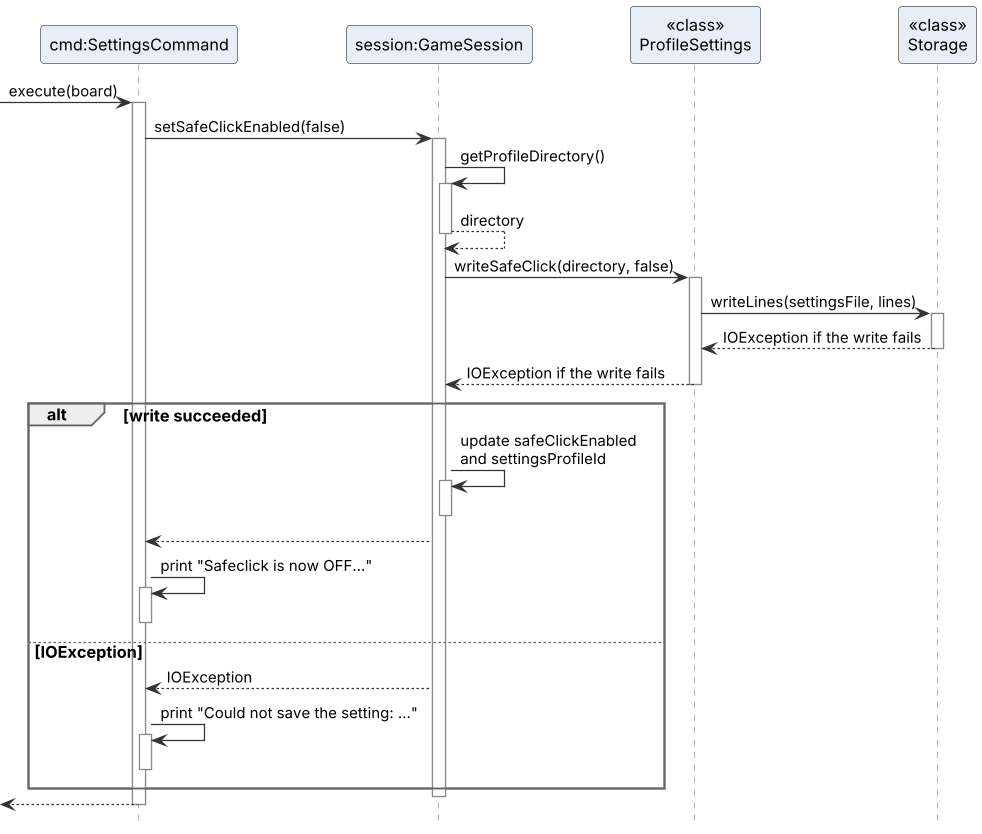

The object diagram below shows the objects after Step 1.

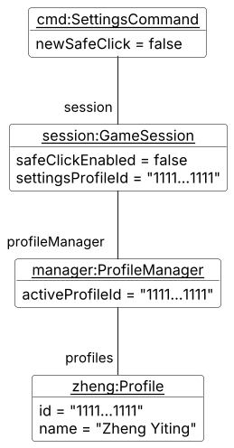

> **Note:** A missing or malformed settings file means the default (on), and the file is not overwritten until the player changes the setting.

#### Design considerations:

**Aspect: Where the setting is stored**

* **Alternative 1 (current choice):** A separate `settings.txt` per profile.
  * Pros: The strictly validated `profiles.txt` format is unchanged.
  * Cons: One more file to read and write.
* **Alternative 2:** An extra column in `profiles.txt`.
  * Pros: One file for all profile data.
  * Cons: A format change affects every profile.

### Chaining commands

Several commands can be typed on one line, separated by `;`, for example `new hard; f 15 29`.

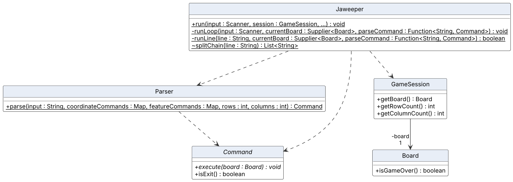

Given below is an example usage scenario of `new hard; f 15 29`.

Step 1. `splitChain` splits the line on `;`, trims each part and drops empty parts.

Step 2. Each part is parsed against the **current** board size just before it runs. `f 15 29` is therefore checked against the 16×30 board that `new hard` created.

Step 3. A part that fails prints its error and the next part still runs. An accepted `exit` stops the loop, and if the game ends part-way, the remaining parts are skipped with one message.

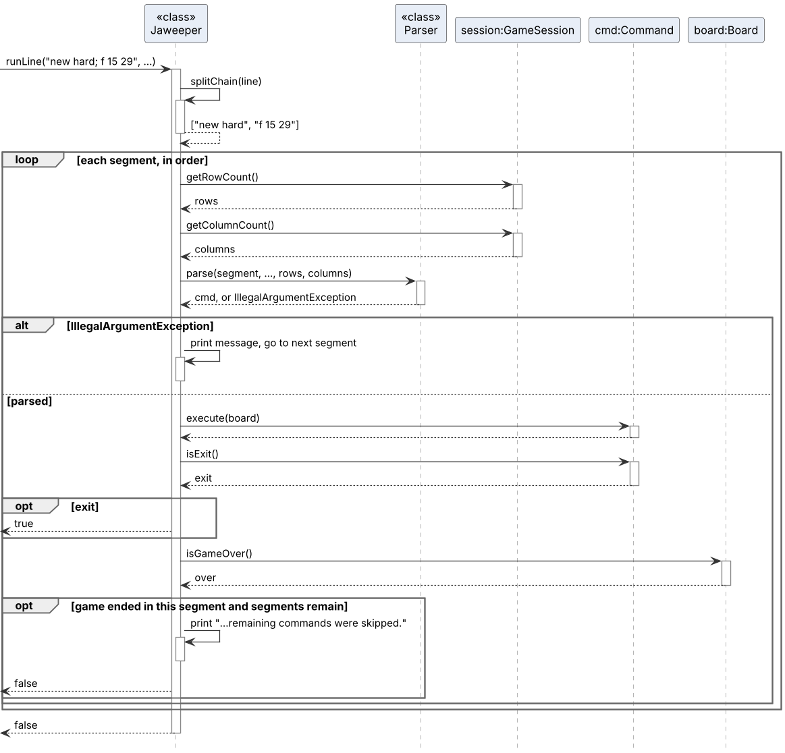

The object diagram below shows both commands after they were parsed. `second` stores row 14 and column 28, which is valid only on the new board.

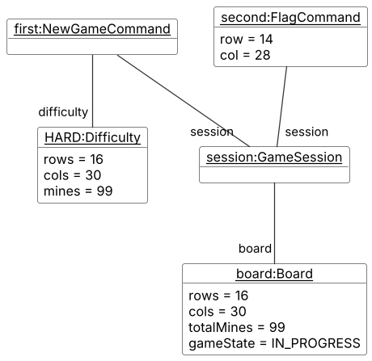

> **Note:** `exit; exit` and `delete x; delete x` on one line count as confirmed repeats.

#### Design considerations:

**Aspect: When each command is parsed**

* **Alternative 1 (current choice):** Parse each part just before it runs.
  * Pros: Later parts are checked against the board as earlier parts left it.
  * Cons: A parse error is only reported when that part is reached.
* **Alternative 2:** Parse the whole line first.
  * Pros: All syntax errors are reported before anything runs.
  * Cons: `f 15 29` would be rejected against the old 9×9 board.

### Deleting a saved game

`saves` lists the active profile's saved games, and `delete NAME`, typed twice, deletes one.

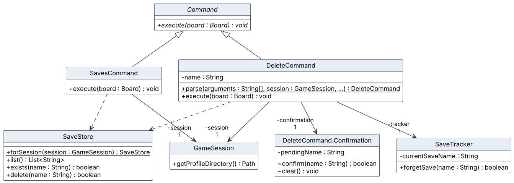

A command object lives for only one input line, so the remembered name is kept in a `DeleteCommand.Confirmation` object that `Jaweeper.createFeatureCommands` creates once and passes to every `delete` command.

Given below is an example usage scenario.

Step 1. The player types `delete trip`. The save exists, so `confirmation.confirm("trip")` remembers the name and returns `false`, and a warning is printed.

Step 2. The player types `delete trip` again. The object diagram below shows the objects just before this second command executes.

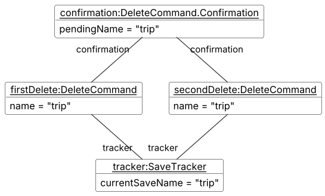

Step 3. `confirm("trip")` now returns `true`, and the file is deleted. Because `trip` was the current game's save, `forgetSave` makes the game count as unsaved again.

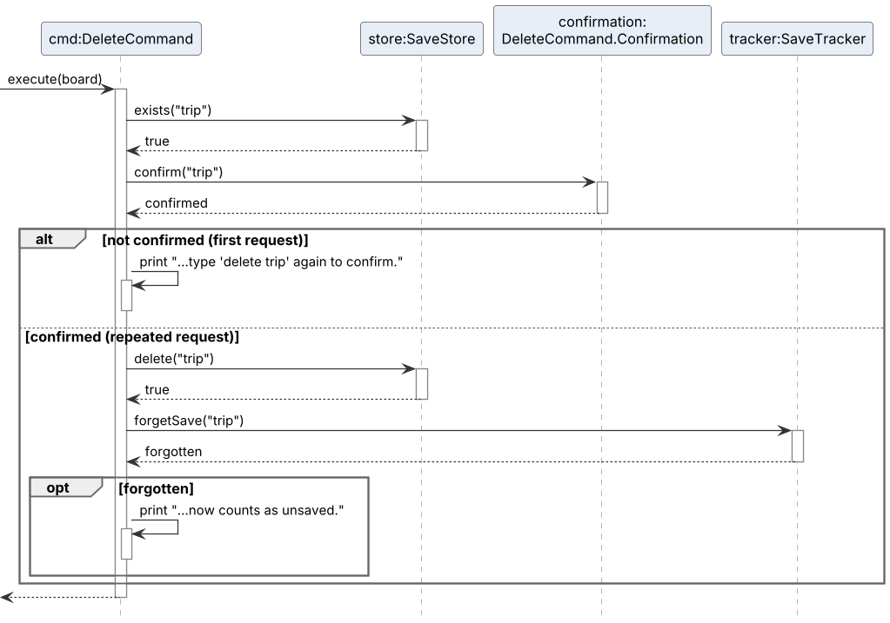

> **Note:** If no save has that name, a message is printed and any pending confirmation is cleared. Deleting does not decode the file, so a corrupted save can still be deleted.

#### Design considerations:

**Aspect: Where the pending confirmation is kept**

* **Alternative 1 (current choice):** One shared `DeleteCommand.Confirmation` object.
  * Pros: Keeps delete logic out of `SaveTracker` and avoids global state.
  * Cons: One more object to pass to each `delete` command.
* **Alternative 2:** A static field in `DeleteCommand`.
  * Pros: Nothing to pass around.
  * Cons: Global state leaks between tests and between profiles.

--------------------------------------------------------------------------------------------------------------------

## Documentation, logging, testing, dev-ops

* **Documentation:** The User Guide and this guide are in `docs/`. Diagram sources are in `docs/diagrams/` and the rendered images in `docs/images/`.
* **Logging:** Classes use `java.util.logging`. Session start and end are logged at `INFO`, and command dispatch and rejected input at `FINE`. Full user input is not logged.
* **Testing:** Run `./gradlew test`. Tests that touch files use JUnit temporary folders, so they never change real player data. Shared setup for session-based tests is in `SessionTestBase`.
* **Dev-ops:** GitHub Actions (`.github/workflows/gradle.yml`) runs `./gradlew check` on every push and pull request. Checkstyle rules are in `config/checkstyle/`.

--------------------------------------------------------------------------------------------------------------------

## Appendix: Requirements

### Product scope

**Target user profile**:

* plays short Minesweeper games in a terminal
* prefers typing commands to using a mouse
* is comfortable running a Java application
* may share a computer with other players, one at a time

**Value proposition**: play Minesweeper with selectable difficulty, named saves and per-player statistics, entirely from the keyboard.

### User stories

Priorities: High (must have) - `* * *`, Medium (nice to have) - `* *`, Low (unlikely to have) - `*`

| Priority | As a …​ | I want to …​ | So that I can…​ |
|---|---|---|---|
| `* * *` | new player | view command help | learn the inputs and the coordinate range |
| `* * *` | player | reveal, flag and unflag cells | solve a board with the keyboard |
| `* * *` | returning player | create or choose a profile at launch | keep my saves and settings separate |
| `* * *` | player | start an easy, medium or hard game | choose the challenge |
| `* * *` | player | save and load an unfinished game | continue it later |
| `* *` | player | start a custom-sized game | practise a particular board |
| `* *` | player | list and delete saves | manage my stored games |
| `* *` | player | undo my last move | recover from a mistyped coordinate |
| `* *` | player | ask for a hint | get unstuck |
| `* *` | player | view my statistics and a leaderboard | track my progress |
| `* *` | player | turn safeclick on or off | choose how the first move behaves |
| `* *` | player | manage profiles during play | switch players without relaunching |
| `* *` | player | see all mines after I lose | learn from my mistakes |
| `*` | experienced player | chain commands with `;` | make several moves at once |

### Use cases

(For all use cases below, the **System** is `Jaweeper` and the **Actor** is the `player`, unless specified otherwise)

**Use case: UC01 - Start playing**

**MSS**

1. Player launches Jaweeper.
1. Jaweeper lists the existing profiles.
1. Player selects a profile.
1. Jaweeper shows a new easy board.

    Use case ends.

**Extensions**

* 2a. There are no profiles.
    * 2a1. Player creates a profile.

      Use case resumes at step 4.
* 3a. The profile number is invalid.
    * 3a1. Jaweeper shows an error message.

      Use case resumes at step 2.

**Use case: UC02 - Reveal a cell**

**MSS**

1. Player requests to reveal a cell.
1. Jaweeper reveals the cell and its blank neighbours, and shows the board.

    Use case ends.

**Extensions**

* 1a. The coordinates are invalid, or the cell is flagged.
    * 1a1. Jaweeper shows an error message.

      Use case ends.
* 2a. The cell is a mine.
    * 2a1. Jaweeper shows all mines, records a loss and ends the game.

      Use case ends.
* 2b. All safe cells are now revealed.
    * 2b1. Jaweeper records a win and ends the game.

      Use case ends.

**Use case: UC03 - Save a game**

**MSS**

1. Player requests to save the game under a name.
1. Jaweeper saves the game and confirms.

    Use case ends.

**Extensions**

* 1a. The name is invalid.
    * 1a1. Jaweeper shows an error message.

      Use case ends.
* 1b. The game is already finished.
    * 1b1. Jaweeper says there is nothing to save.

      Use case ends.
* 2a. The file cannot be written.
    * 2a1. Jaweeper shows an error message and the game stays unsaved.

      Use case ends.

**Use case: UC04 - Load a game**

**MSS**

1. Player requests to load a saved game.
1. Jaweeper replaces the current game with the saved one and shows it.

    Use case ends.

**Extensions**

* 1a. The save does not exist or is invalid.
    * 1a1. Jaweeper shows an error message and keeps the current game.

      Use case ends.
* 1b. The current game has unsaved progress.
    * 1b1. Jaweeper warns the player.
    * 1b2. Player repeats the request.

      Use case resumes at step 2.

**Use case: UC05 - Switch profiles**

**MSS**

1. Player requests to list profiles.
1. Jaweeper lists the profiles and marks the current one.
1. Player selects another profile.
1. Jaweeper switches to it and shows a new easy board.

    Use case ends.

**Extensions**

* 3a. The current game has unsaved progress.
    * 3a1. Jaweeper asks the player to save first (UC03).

      Use case ends.

**Use case: UC06 - Delete a saved game**

**MSS**

1. Player requests to list saved games.
1. Jaweeper lists the saved games.
1. Player requests to delete one.
1. Jaweeper warns that deletion is permanent.
1. Player repeats the request.
1. Jaweeper deletes the save.

    Use case ends.

**Extensions**

* 2a. There are no saved games.

  Use case ends.
* 3a. No save has that name.
    * 3a1. Jaweeper shows an error message.

      Use case resumes at step 2.

### Non-Functional Requirements

1. Should work on any _mainstream OS_ as long as it has Java 25 installed.
1. Should be fully usable through text commands in a terminal; coordinates shown to the user are one-based.
1. Should work offline; all data is stored in local UTF-8 text files.
1. Invalid input should produce an explanatory message and never end the program, even with assertions disabled.
1. Every data file should be validated before use, and a failed write should never be reported as a success.
1. Renaming a profile should not move or lose its saved games or settings.
1. A board up to 50×50 should respond to a command without noticeable delay.
1. Only one instance of the app is expected to use a data folder at a time.

### Glossary

* **Mainstream OS**: Windows, Linux, Unix, MacOS
* **Board / cell**: The rectangular minefield / one position in it
* **Reveal**: Open a cell; a safe cell shows how many adjacent cells hold mines
* **Flag**: Mark a cell the player believes holds a mine
* **Flood fill**: Revealing connected blank cells and their numbered border
* **Safeclick**: The setting that makes the first reveal of a game safe
* **Profile**: A local player, identified by a stable UUID
* **Command factory**: A function that validates arguments and constructs a command
* **Unsaved progress**: Moves made since the last save or load of the current game

--------------------------------------------------------------------------------------------------------------------

## Appendix: Instructions for manual testing

Given below are instructions to test the app manually.

> **Note:** These instructions only provide a starting point for testers to work on; testers are expected to do more *exploratory* testing. Board generation is random, so check sizes, flags and messages rather than mine positions.

### Launch and shutdown

1. Initial launch

   1. Copy the JAR into an empty folder and run `java -ea -jar jaweeper.jar` there.<br>
      Expected: A profile prompt saying there are no profiles yet.

   1. Test case: `create DG Tester`<br>
      Expected: Profile selected and an empty 9×9 board shown.

1. Profile persistence

   1. Type `exit`, then relaunch from the same folder.<br>
      Expected: `DG Tester` is listed.

   1. Test case: `create dg tester`<br>
      Expected: Rejected as a duplicate name.

   1. Test case: `select 999`<br>
      Expected: An invalid-selection message, and the prompt is shown again.

### Playing a game

1. Revealing and flagging with invalid input

   1. Test case: `r 0 1`, `r 10 1`, `r abc 1`<br>
      Expected: Each is rejected with an error message. No cell is revealed.

1. Boards of different sizes

   1. Test case: `new hard`<br>
      Expected: A 16×30 board with `Remaining Mines: 99`.

   1. Test case: `new custom 5 5 25`<br>
      Expected: Rejected, because mines must be fewer than cells.

   1. Test case: `new custom 5 6 3`<br>
      Expected: A 5×6 board.

1. Undo and hints

   1. Test case: `f 1 1`, then `undo`<br>
      Expected: The flag appears, then disappears.

   1. Test case: `hint` on a fresh board<br>
      Expected: `No safe cell can be deduced yet. Reveal more cells.`

1. Chaining

   1. Test case: `new easy; f 9 9; board`<br>
      Expected: A 9×9 board with the bottom-right cell flagged.

   1. Test case: `unknown; board`<br>
      Expected: An error message, then the board.

### Switching profiles

1. Switching with unsaved progress

   1. Prerequisites: `profile create Guest`, then `f 1 1`.

   1. Test case: `profile select 2`<br>
      Expected: A message asking the player to save first. The board is unchanged.

   1. Test case: `save check`, then `profile select 2`<br>
      Expected: Guest is active with a fresh board. `undo` reports nothing to undo.

1. Deleting a profile

   1. Test case: `profile delete 2 confirm` while Guest is active<br>
      Expected: Rejected.

   1. Test case: `profile select 1`, `profile delete 2`, then `profile delete 2 confirm`<br>
      Expected: A warning, then Guest is removed.

### Saving data

1. Saving and loading

   1. Test case: `new`, `f 1 1`, `save dg-check`<br>
      Expected: `Game saved as 'dg-check'.`

   1. Test case: `u 1 1`, `load dg-check`, then `load dg-check` again<br>
      Expected: A warning first, then the saved board with the flag at row 1, column 1.

   1. Test case: `load no-such-save`<br>
      Expected: An error message. The current board is unchanged.

1. Dealing with corrupted data files

   1. Edit one board character in `data/profiles/<UUID>/saves/dg-check.txt`, then `load dg-check`.<br>
      Expected: Rejected as changed outside Jaweeper or damaged. The current board is unchanged.

   1. In a separate test folder, change the first line of `data/profiles.txt` to `invalid-header` and relaunch.<br>
      Expected: An error about the profile registry. The file is not overwritten.

1. Unsaved progress on exit

   1. Test case: `u 1 1`, then `exit`<br>
      Expected: A warning. A second `exit` closes the app.

### Settings and saved games

1. Safeclick

   1. Test case: `settings safeclick off`, `exit`, relaunch with the same profile, `settings`<br>
      Expected: Safeclick is shown as OFF.

1. Listing and deleting saves

   1. Test case: `saves`, then `delete dg-check` twice<br>
      Expected: The save is listed, then a warning, then the save is deleted.
