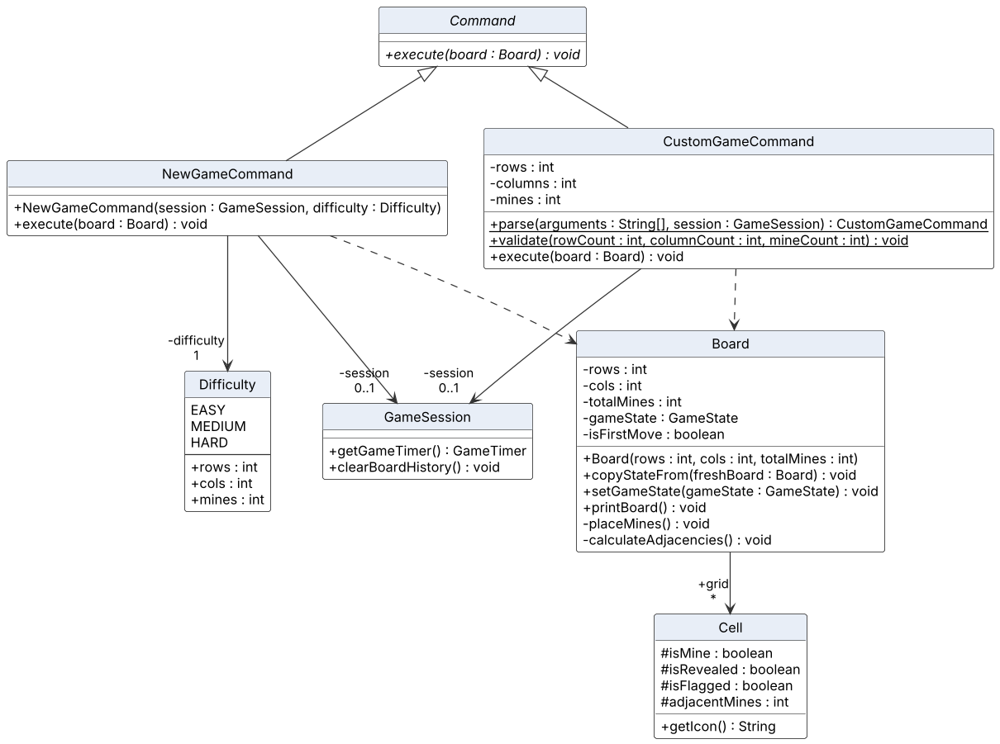
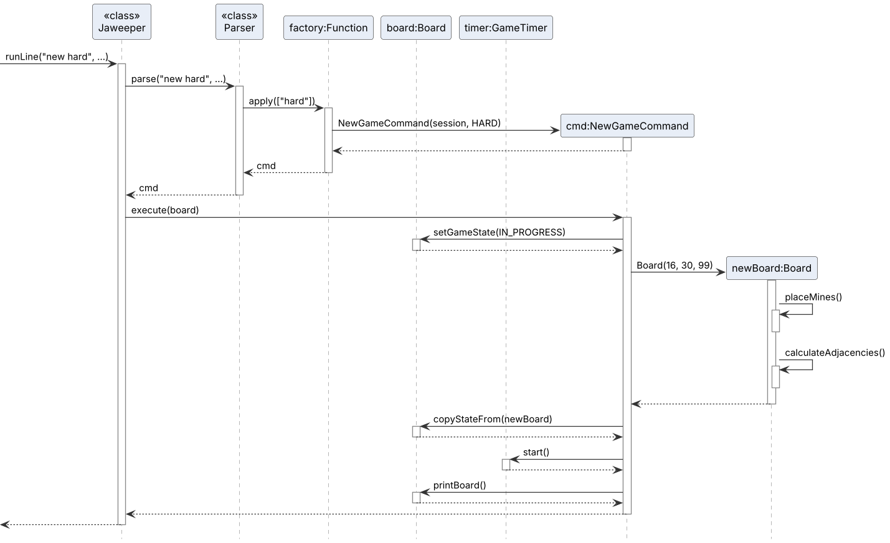
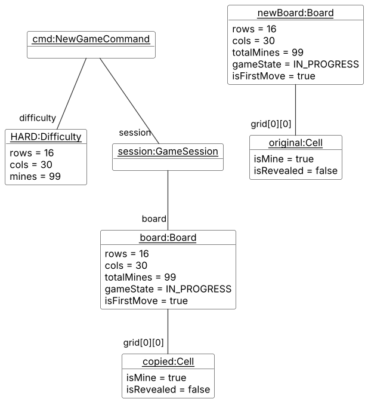
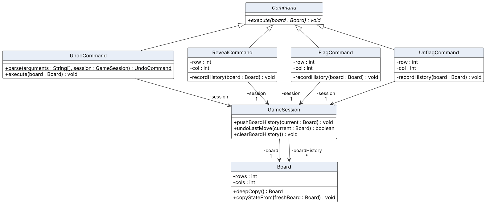
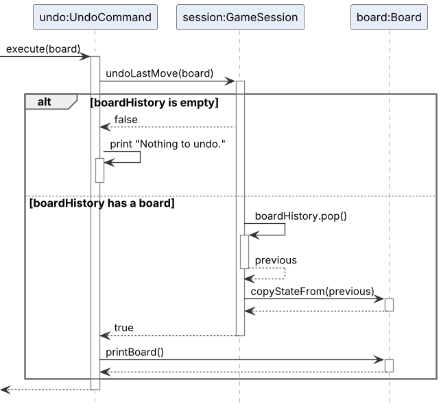

# Project Portfolio Page - Pranav

## PROJECT: Jaweeper

[Jaweeper](https://github.com/AY2627S1-CS2113-W10-4/tp) is a command-line Minesweeper game written in Java for CS2113. Players choose a profile, then reveal and flag cells, start boards of different sizes, undo a move, and save games under that profile. The product uses a shared `GameSession` so every command sees the same board.

Given below are my contributions to the project.

* **New Feature**: Added custom games (`new custom ROWS COLS MINES`).
    * What it does: starts a board of the size and mine count the player chooses. Each side must be a whole number from 5 to 50, and the mine count must be at least 1 and strictly fewer than the number of cells. The previous board is discarded and the undo history is cleared.
    * Justification: the three presets are not enough when a player wants a short practice board or a larger one. Rejecting illegal sizes before a board is built keeps a bad command from changing the game in progress.
    * Highlights: `CustomGameCommand` is reached from the existing `new` factory before the preset check, so `new easy`, `new medium`, `new hard` and `new custom` stay one command. Validation runs before `rows * cols` is used as a mine limit. `CustomGameCommandTest` covers negative and zero sizes, the 4 and 51 boundaries, too many mines, non-integers, and a valid 5×5, 10×12 and 50×50 board.
    * Credits: none. The size limits follow the usual Minesweeper custom-board idea.

* **New Feature**: Added undo (`undo`).
    * What it does: takes back the last reveal, flag or unflag, one move at a time. The timer keeps running. An empty history prints `Nothing to undo.`
    * Justification: a mistyped coordinate or a wrong flag is otherwise permanent in a command-line game. Undo lets the player recover without starting again.
    * Highlights: `GameSession` keeps a `Stack<Board>`. Reveal, flag and unflag push `Board.deepCopy()` before they change the board. Undo pops that copy and writes it back with `copyStateFrom`, so the session keeps the same `Board` object. `new custom` and a profile switch clear the stack, so undo cannot jump into another game. `UndoCommandTest` covers an empty stack, several flags undone one at a time, a reveal, an unflag, and extra arguments.
    * Credits: none.

* **Code contributed**: [RepoSense contribution view](https://nus-cs2113-ay2627-s1.github.io/tp-dashboard/?search=ProNoob116). Functional code is tagged `// @@author ProNoob116` and includes `CustomGameCommand`, `UndoCommand`, `Board.deepCopy`, the board history on `GameSession`, and the earlier `Difficulty`, `NewGameCommand` and `HintCommand` work.

* **Enhancements to existing features**:
    * Replaced the fixed 9×9 board with `rows`, `cols` and `totalMines`, so placement, flood fill, victory checking and printing follow the current size. `Board.SIZE` and `Board.MINES` remain only for older tests.
    * Added the `Difficulty` presets: easy is 9×9 with 10 mines, medium is 16×16 with 40, and hard is 16×30 with 99. `new` with no word starts an easy game.
    * Added `hint`, which prints one hidden cell that the revealed numbers and flags prove safe, without revealing or flagging it.

* **Documentation**:
    * User Guide: `new easy`, `new medium`, `new hard`, `new custom`, `hint`, `undo`, and the FAQ entry on undoing after a mine. Added the matching command-summary rows.
    * Developer Guide: "Creating a board", "Undoing a move" and "Getting a hint", each with a class diagram, a sequence diagram and an object diagram. Added the manual tests for a rejected custom board, a 5×6 custom board, and undo after a flag.

* **Team contributions**:
    * The integration note assigns me difficulty, custom boards and the remaining-mine display. Teammates' coordinate checks and `new hard; f 16 30` depend on the dynamic size.
    * Undo history is cleared when a profile switch succeeds, so another player's board cannot be restored with `undo`.
    * Drew the board, undo and hint diagrams used in the Developer Guide. The undo object-diagram source is [`docs/diagrams/UndoObjectDiagram.puml`](../diagrams/UndoObjectDiagram.puml).

## Contributions to the User Guide

Given below are sections I contributed to the User Guide. They showcase my ability to write documentation targeting end-users.

### Starting a custom game: `new custom`

Starts a new game with the number of rows, columns and mines you choose. The previous board is discarded and the undo history is cleared.

Format: `new custom ROWS COLS MINES`

* `ROWS` and `COLS` must be whole numbers from 5 to 50.
* `MINES` must be at least 1 and fewer than `ROWS` × `COLS`.

Example:

`new custom 5 6 3`

Expected output:

```text
> new custom 5 6 3
New custom game started (5x6, 3 mines).
Remaining Mines: 3
      1   2   3   4   5   6
    +---+---+---+---+---+---+
  1 | . | . | . | . | . | . |
```

The full board has 5 rows. These inputs are rejected, and the current board stays as it is:

```text
> new custom 4 6 3
Custom boards must be at least 5 by 5.

> new custom 5 51 3
Custom boards cannot exceed 50 by 50.

> new custom 5 5 25
Mines must be fewer than the number of cells.

> new custom 5 5 0
A custom board needs at least 1 mine.

> new custom 5 x 3
Rows, columns, and mines must be integers.

> new custom 5 6
Usage: new custom ROWS COLS MINES
```

### Undoing a move: `undo`

Takes back your last reveal, flag or unflag. You can type `undo` several times to step further back. The timer keeps running.

Format: `undo`

Example: flag two cells, then undo the second flag.

```text
> f 1 1
Cell (1, 1) flagged.
Remaining Mines: 2
...
> f 1 2
Cell (1, 2) flagged.
Remaining Mines: 1
...
> undo
Undid the last move.
Remaining Mines: 2
```

The board is printed again after each line marked `...`. When there is nothing left to undo:

```text
> undo
Nothing to undo.
```

`undo` takes no extra words:

```text
> undo please
Usage: undo
```

`new custom` and switching profiles clear the undo history.

### FAQ

**Q**: Can I undo after hitting a mine?

**A**: Yes. `undo` takes back the reveal that hit the mine, so you can keep playing that game. The loss is still counted in your statistics.

### Command summary rows

| Command | What it does |
|---|---|
| `new custom ROWS COLS MINES` | Starts a custom game (5–50 rows and columns, at least 1 mine). |
| `undo` | Takes back your last reveal, flag or unflag. |

## Contributions to the Developer Guide

Given below are sections I contributed to the Developer Guide. They showcase my ability to write technical documentation and the technical depth of my contributions to the project.

### Creating a board

`new [easy|medium|hard]` starts a preset game and `new custom ROWS COLS MINES` starts a custom one. `EASY` is 9×9 with 10 mines, `MEDIUM` is 16×16 with 40, and `HARD` is 16×30 with 99.



`Board` stores its own `rows`, `cols` and `totalMines`, so all board logic works for any size. `CustomGameCommand.validate` accepts dimensions from 5 to 50 and a mine count from 1 to cells − 1.

Given below is an example usage scenario of `new hard`.

Step 1. The `new` factory receives `["hard"]` and constructs `NewGameCommand(session, HARD)`. Any other word throws `Usage: new [easy|medium|hard]` and the current board is kept.

Step 2. `execute` builds `Board(16, 30, 99)`, which places 99 mines at random and counts adjacent mines.

Step 3. `copyStateFrom` copies the size, cells, state and first-move flag into the board the session already holds. The timer restarts and the new board is printed.



The object diagram below shows the objects just after `copyStateFrom`. `copied` and `original` are different `Cell` objects with the same values.



> **Note:** `new custom R C M` follows the same steps through `CustomGameCommand` and also clears the undo history. The first reveal of either board is protected by safeclick.

#### Design considerations:

**Aspect: How the new board is installed**

* **Alternative 1 (current choice):** Copy the new board's state into the existing `Board` object.
  * Pros: Every holder of the board reference sees the new game.
  * Cons: Builds a temporary second board.
* **Alternative 2:** Replace the session's board with `replaceBoard`.
  * Pros: No copying.
  * Cons: Any object still holding the old reference would see a stale board.

### Undoing a move

`undo` restores the board as it was before the last reveal, flag or unflag.



Given below is an example usage scenario and how the undo mechanism behaves at each step.

Step 1. The player flags one cell. Before flagging, `FlagCommand` calls `session.pushBoardHistory(board)`, which pushes `board.deepCopy()` onto `boardHistory`.

Step 2. The player flags a second cell. Another copy, now containing the first flag, is pushed.

Step 3. The player types `undo`. `undoLastMove` pops the top copy and copies it onto the live board with `copyStateFrom`.



The object diagram below shows the objects after Step 3. The second flag is gone, and the stack still holds the board from before the first flag. The timer keeps running.


> **Note:** If the history is empty, `undo` prints `Nothing to undo.` `new custom` and switching profiles clear the history. A preset `new` currently does not, so `undo` straight after it brings back the last board of the previous game.

#### Design considerations:

**Aspect: How undo states are stored**

* **Alternative 1 (current choice):** Save a full copy of the board before each move.
  * Pros: Easy to implement and always correct.
  * Cons: Uses more memory on large boards.
* **Alternative 2:** Each command knows how to undo itself.
  * Pros: Uses less memory.
  * Cons: Every command needs its own undo logic, which is easy to get wrong (e.g. flood fill).
